<h1 align="center">Tempos 사용자 매뉴얼</h1>

  <strong>시간과 날씨, PC 상태와 일정을 바탕화면에.</strong> 
  필요한 위젯을 골라 크기와 위치를 맞추는 Windows 앱입니다.

  <a href="https://github.com/poyal/tempos/releases/latest">최신 다운로드</a> ·
  <a href="#install">처음 시작하기</a> ·
  <a href="#gallery">9종 위젯 보기</a> ·
  <a href="https://github.com/poyal/tempos/issues">문의·오류 신고</a>

**Windows 11 · Intel/AMD x64 · Tempos 계정 없이 사용 · .NET 별도 설치 불필요**

시계·시스템 사용량·로컬 달력은 서비스 계정 없이 사용할 수 있습니다. 날씨에는 인터넷이 필요하며 Google 일정 연결과 CPU 온도 표시는 선택 기능입니다. 위젯 배치와 설정은 내 PC에 저장합니다.

[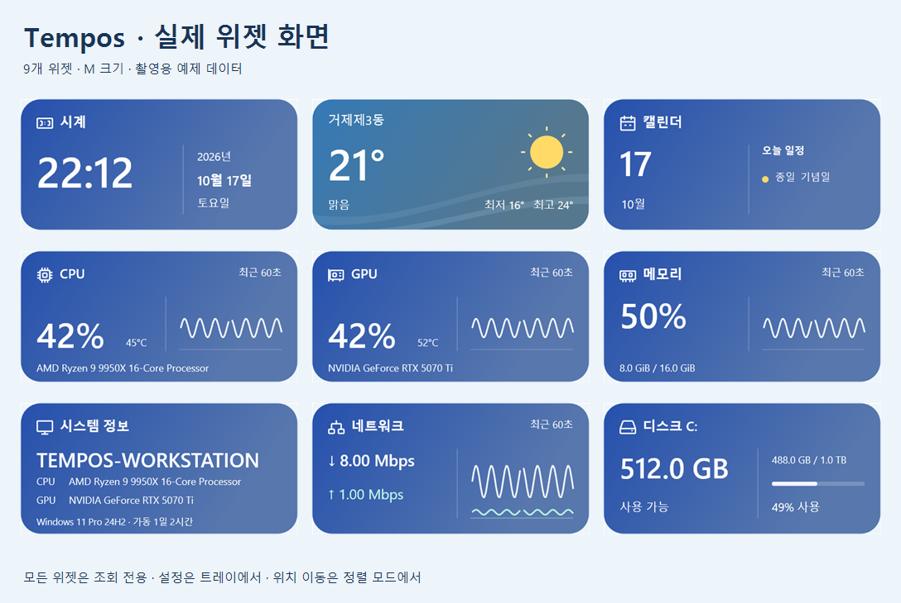](docs/assets/readme-2026-10-17/overview.png)

처음이라면 **설치 → 트레이에서 설정 열기 → 위젯 추가·배치 → 필요한 서비스 연결 → 레이아웃 백업** 순서로 따라 해 보세요.

화면은 **0.1.2 · 2026-10-17** 소스로 실행한 앱의 예제입니다. 날씨·일정·장치명·측정값은 촬영용 자료이며 실제 계정이나 현재 위치를 사용하지 않았습니다. 이미지를 누르면 크게 볼 수 있습니다. [전체 화면과 촬영 조건](docs/screenshots.md#manual-20261017).

## 어떤 위젯이 있나요?

| 위젯 | 확인할 수 있는 정보 | 주요 설정 |
| --- | --- | --- |
| [시계](#widget-clock) | 디지털 시간과 날짜 | 초 표시, 12/24시간제, 시간대 |
| [날씨](#widget-weather) | 국내 지역 날씨·기온·예보 | 지역, 서비스, 자동 배경, 섭씨/화씨 |
| [CPU](#widget-cpu) | CPU 사용률·온도·사용률 추이 | 그래프, 갱신 주기, 선택 기능인 CPU 온도 |
| [GPU](#widget-gpu) | 선택 GPU의 사용률·온도 | GPU 선택, 그래프, 갱신 주기 |
| [메모리](#widget-memory) | 물리 메모리 사용률·사용량·전체 용량 | 그래프, 갱신 주기 |
| [시스템 정보](#widget-system) | PC 이름·Windows·CPU·GPU·가동 시간 | 표시할 항목 |
| [네트워크](#widget-network) | 수신·송신 속도와 추이 | 전체 또는 개별 장치, 비트/바이트 단위 |
| [디스크](#widget-disk) | 드라이브 사용량과 여유 공간 | 볼륨, 십진/이진 단위 |
| [캘린더](#widget-calendar) | 날짜·월간 달력·연결한 일정 | 시간대, 주 시작 요일, 표시할 캘린더 |

모든 위젯은 **S · Slim · M · L**을 지원하며 캘린더에는 **XL**도 있습니다. 같은 종류를 여러 개 추가해 서로 다른 시간대·지역·장치를 볼 수 있습니다.

## 목차

1. [설치하고 처음 실행하기](#install)
2. [화면과 트레이 익히기](#window)
3. [위젯 추가·배치·숨기기](#widgets)
4. [9종 위젯과 크기별 사용법](#gallery)
5. [크기·테마·표시 옵션 바꾸기](#appearance)
6. [날씨 서비스와 지역 설정하기](#weather)
7. [Google 캘린더 연결하기](#calendar)
8. [CPU 온도 켜기](#temperature)
9. [Windows 로그인 시 자동 시작하기](#startup)
10. [백업·복원·기기 변경하기](#backup)
11. [업데이트와 제거](#update)
12. [막혔을 때 확인하기](#help)

## 설치하고 처음 실행하기

### 설치 EXE로 시작하기

1. [최신 다운로드](https://github.com/poyal/tempos/releases/latest)를 엽니다.
2. 릴리즈의 **Assets**에서 `Tempos-…-win-x64.exe` 파일을 받습니다.
3. 파일을 실행하고 설치할 폴더를 고른 뒤 **설치**를 누릅니다. 기본 위치는 `%LocalAppData%\Programs\Tempos`입니다.
4. **Tempos 실행**을 선택하고 **마침**을 누릅니다. 다음부터는 시작 메뉴나 바탕화면의 **Tempos** 바로가기로 실행하세요.

현재 Windows 사용자에게 설치하며 기본 앱은 일반 권한으로 실행합니다. [CPU 온도용 센서 도우미](#temperature)는 처음 설치할 때 별도의 관리자 승인이 필요합니다.

### 설치 없이 ZIP으로 시작하기

같은 릴리즈의 `Tempos-…-win-x64.zip`을 새 폴더에 모두 풀고 **Tempos.exe**를 실행하세요. 함께 들어 있는 **data** 폴더와 구성요소를 유지합니다. ZIP 사용 시에도 설정은 앱 폴더가 아닌 내 Windows 사용자 데이터 폴더에 저장합니다.

### 첫 화면 확인하기

처음 실행하면 시계·날씨·CPU·GPU·메모리 다섯 위젯과 설정창이 열립니다. 날씨는 기본으로 Open-Meteo와 서울특별시 종로구를 사용하므로 [내 지역으로 바꾸기](#weather)를 진행하세요.

[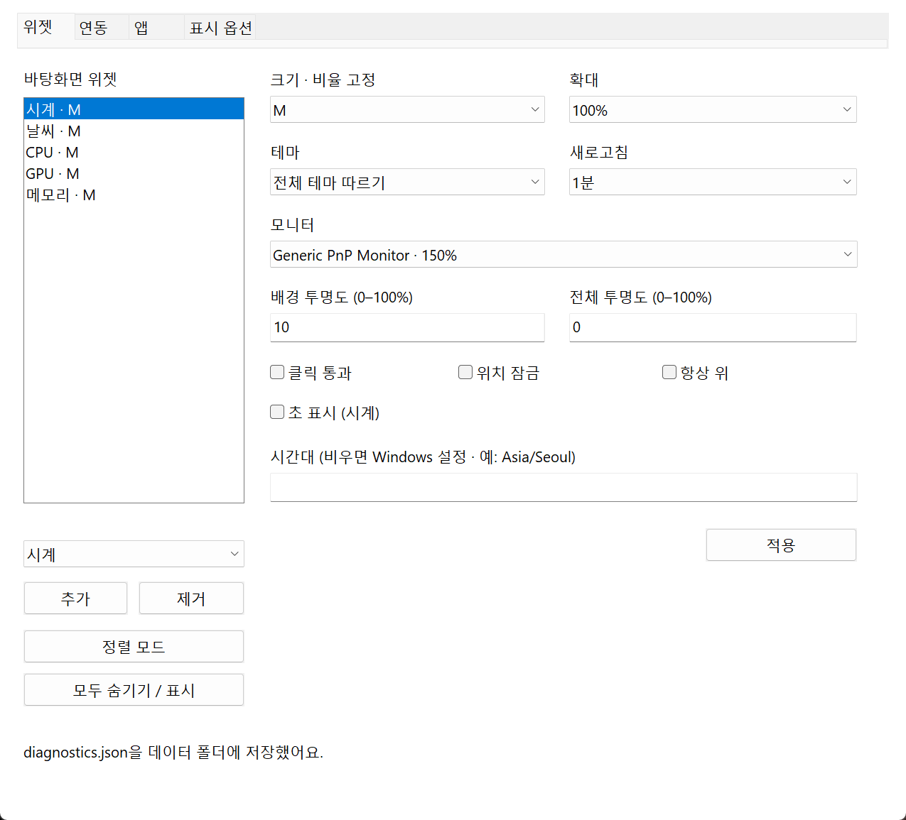](docs/assets/readme-2026-10-17/usage-first-launch.png)

## 화면과 트레이 익히기

설정창은 작업표시줄 알림 영역의 **Tempos 아이콘**에서 다시 엽니다. 아이콘이 보이지 않으면 **^** 안을 확인하세요.

| 설정 탭 | 하는 일 |
| --- | --- |
| **위젯** | 추가·제거·정렬, 크기·테마·투명도·모니터, 지역·장치·시간대 선택 |
| **연동** | 날씨 서비스·기상청 인증키, Google 캘린더 연결 |
| **앱** | 전체 테마, 자동 시작, 백업·복원, CPU 온도, 진단, 종료 |
| **표시 옵션** | 선택한 위젯의 시간·단위·주 시작 요일·시스템 정보 표시 항목 |

**설정창의 X는 창만 닫습니다.** 위젯은 계속 실행됩니다. 완전히 종료하려면 **앱 → Tempos 종료** 또는 트레이 메뉴의 종료 항목을 사용하세요.

위젯 본체는 정보를 보는 화면입니다. 클릭·더블클릭·우클릭으로 설정이나 상세 창을 열지 않습니다. 위치를 옮길 때는 설정창에서 **정렬 모드**를 켭니다.

## 위젯 추가·배치·숨기기

### 추가하고 설정 적용하기

1. **위젯** 탭 왼쪽 아래에서 종류를 고르고 **추가**를 누릅니다.
2. 왼쪽 목록에서 바꿀 위젯을 선택합니다.
3. 오른쪽에서 크기·확대·모니터와 필요한 항목을 고릅니다.
4. **적용**을 누르고 바탕화면의 결과를 확인합니다. 다른 위젯을 선택하기 전에 적용하세요.

[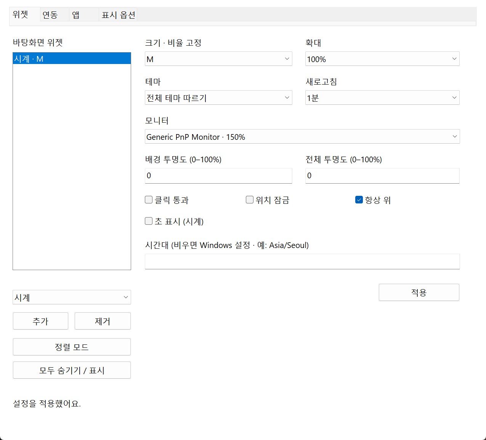](docs/assets/readme-2026-10-17/usage-add-apply.png)

추가·제거는 바로 저장됩니다. 입력란과 선택 상자를 바꾼 것만으로는 저장되지 않습니다. 시간 형식이나 단위는 **표시 옵션 → 표시 옵션 적용**으로 따로 저장합니다.

### 드래그로 배치하기

1. **정렬 모드**를 누릅니다.
2. 바탕화면의 위젯을 원하는 위치로 드래그합니다. 위치가 저장됩니다.
3. 배치가 끝나면 **정렬 모드**를 다시 눌러 끕니다.

[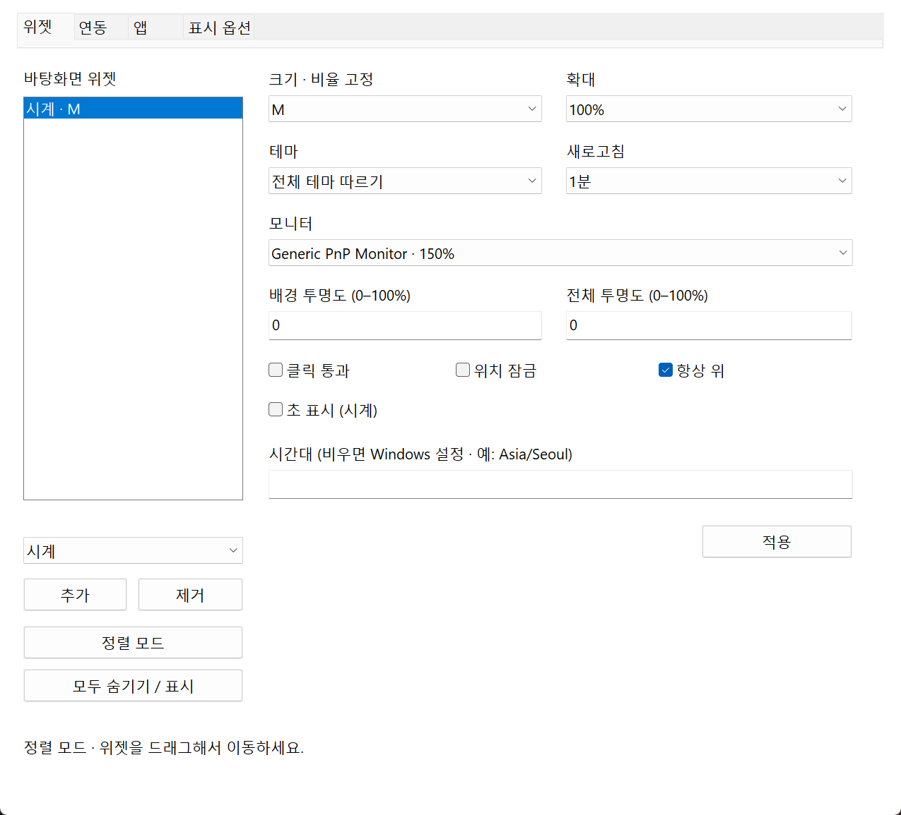](docs/assets/readme-2026-10-17/usage-arrange.png)

정렬 모드의 위젯 화면 보기

[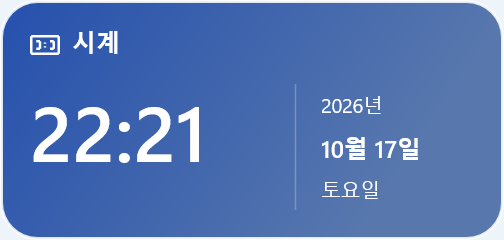](docs/assets/readme-2026-10-17/usage-arrange-widget.png)

드래그가 안 되면 해당 위젯의 **위치 잠금**을 해제하고 **적용**하세요. 화면에 빈 공간이 없으면 추가나 크기 변경이 적용되지 않습니다. 다른 위젯을 옮기거나 크기를 줄인 뒤 다시 적용합니다. 최대 64개까지 저장할 수 있습니다.

### 숨기거나 제거하기

**모두 숨기기 / 표시**는 전체 위젯을 함께 숨기거나 다시 보여줍니다. 숨김 상태는 재실행 후에도 유지합니다.

하나를 없애려면 목록에서 대상을 선택하고 **제거**를 누릅니다. 제거한 위젯을 되돌릴 계획이라면 먼저 [레이아웃을 내보내세요](#backup).

## 9종 위젯과 크기별 사용법

아래 크기 비교는 같은 배율로 배치한 실제 위젯 화면입니다. 캘린더 XL은 별도 이미지로 제공합니다. 각 위젯의 공통 크기·테마·투명도 설정은 [표시 옵션 안내](#appearance)를 참고하세요.

### 시계 — 시간과 날짜

[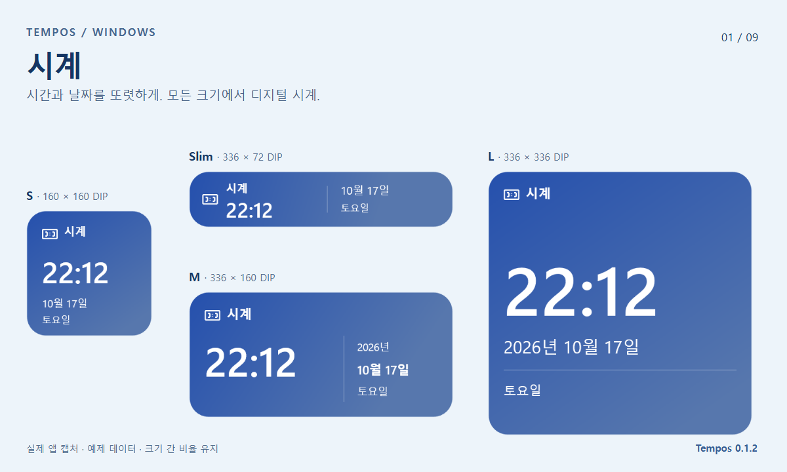](docs/assets/readme-2026-10-17/clock-sizes.png)

모든 크기에서 디지털 시간과 날짜를 보여줍니다. S는 작은 카드, Slim은 가로로 긴 줄, M·L은 여유 있는 글자 배치로 사용할 수 있습니다.

1. **위젯**에서 시계를 선택합니다.
2. **초 표시 (시계)**와 **시간대**를 정하고 **적용**합니다. 시간대를 비우면 Windows 설정을 사용하며, 다른 지역은 `Asia/Seoul`처럼 입력합니다.
3. 오전·오후로 보려면 **표시 옵션 → 시계 · 오전 / 오후 12시간 표시 → 표시 옵션 적용**을 사용합니다.

초 표시와 새로고침 주기는 함께 조정됩니다. 시계를 여러 개 추가하면 다른 시간대를 나란히 볼 수 있습니다.

### 날씨 — 내 지역의 현재 날씨와 예보

[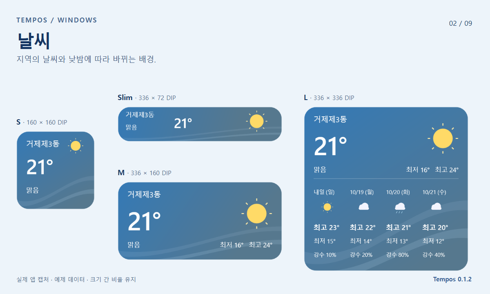](docs/assets/readme-2026-10-17/weather-sizes.png)

S·Slim은 지역·기온·날씨를 간단히 확인하는 데 적합합니다. M은 더 넓은 현재 날씨 요약, L은 **내일부터 4일의 날씨·최고/최저·최대 강수확률**까지 보여줍니다. 자료가 없는 날짜는 **예보 없음**으로 표시합니다.

1. 날씨 위젯을 선택하고 **날씨 지역**을 고른 뒤 **적용**합니다.
2. **날씨 배경 자동**을 켜면 날씨와 낮밤에 맞춰 배경이 바뀝니다. 끄면 선택한 테마를 사용합니다.
3. 화씨가 필요하면 **표시 옵션 → 날씨 · 화씨 (°F) → 표시 옵션 적용**을 누릅니다.

서비스는 모든 날씨 위젯이 공유하고 지역·단위·외형은 위젯마다 정합니다. [서비스 선택과 현재 위치 사용법](#weather).

### CPU — 프로세서 사용률과 온도

S는 사용률과 온도를 간단히 보여주고, Slim·M·L은 최근 60초 추이를 표시할 수 있습니다. L은 평균·최대 사용률도 보여줍니다. CPU 모델명은 M·L 하단에 표시합니다.

1. CPU 위젯을 선택합니다.
2. **그래프**와 **새로고침** 주기를 정하고 **적용**합니다.
3. 온도도 보려면 [CPU 온도 켜기](#temperature)를 진행합니다.

온도를 사용할 수 없어도 사용률은 계속 표시합니다. 온도와 높은 사용률의 색상은 [표시 기준](#temperature-colors)을 따릅니다.

### GPU — 사용할 그래픽 장치 선택

[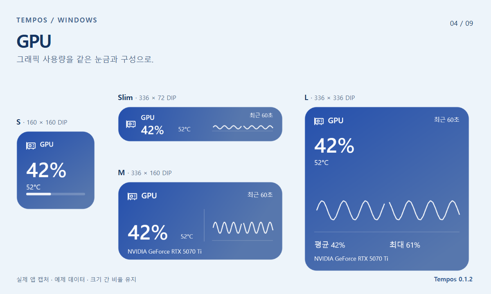](docs/assets/readme-2026-10-17/gpu-sizes.png)

CPU와 같은 크기 구성을 사용합니다. S는 사용률·온도, Slim·M·L은 추이, L은 평균·최대를 확인할 수 있습니다. 모델명은 M·L 하단에 표시합니다.

1. GPU 위젯을 선택합니다.
2. **GPU 장치**에서 확인할 GPU를 고릅니다.
3. 그래프와 새로고침 주기를 정한 뒤 **적용**합니다.

GPU 온도는 Windows와 드라이버가 제공하는 값입니다. CPU 센서 도우미를 설치할 필요는 없으며, 지원하지 않으면 `—`로 표시합니다. 사용률은 집계 방식과 측정 시점에 따라 작업 관리자와 순간 값이 다를 수 있습니다.

### 메모리 — 사용 중인 RAM 확인

[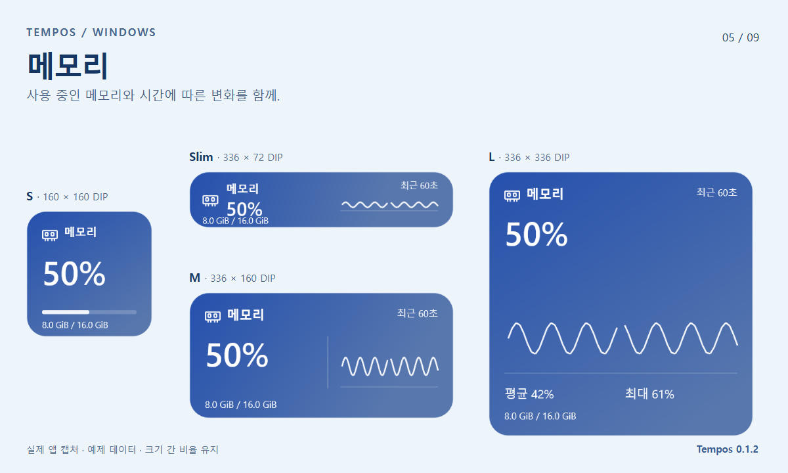](docs/assets/readme-2026-10-17/memory-sizes.png)

물리 메모리의 사용률과 사용량·전체 용량을 함께 확인합니다. Slim·M·L은 최근 60초 추이, L은 평균·최대 사용률을 표시합니다.

**위젯 → 메모리 선택 → 그래프·새로고침 설정 → 적용** 순서로 바꾸세요. 사용량 변화가 작으면 그래프가 수평선에 가깝게 보일 수 있습니다.

### 시스템 정보 — PC 사양과 가동 시간

[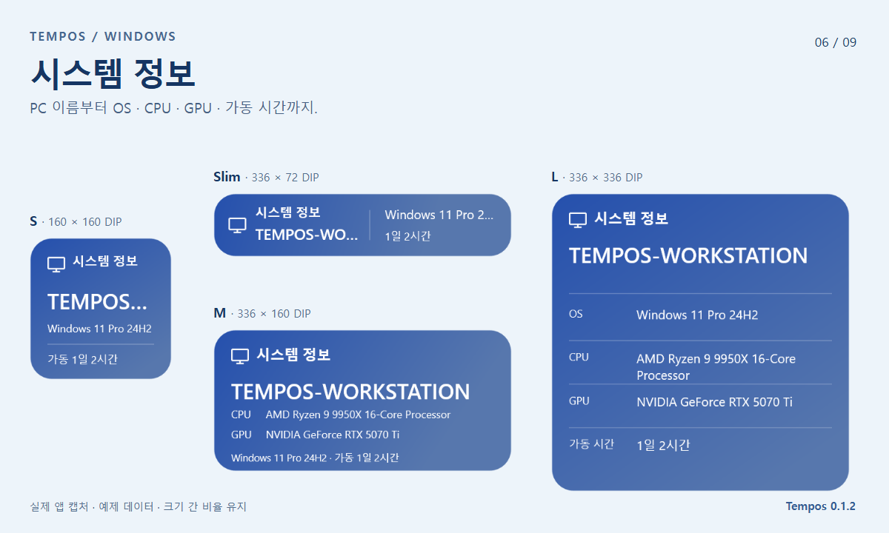](docs/assets/readme-2026-10-17/system-sizes.png)

작은 크기에서는 요약을, 큰 크기에서는 더 많은 사양을 확인합니다. PC 이름·Windows 버전·CPU 이름·GPU 이름·가동 시간 중 필요한 항목을 고를 수 있습니다.

1. **위젯**에서 시스템 정보를 선택합니다.
2. **표시 옵션**에서 표시할 항목을 체크합니다.
3. **표시 옵션 적용**을 누르고 카드에 표시된 내용을 확인합니다.

시스템 정보 표시 항목 설정 보기

[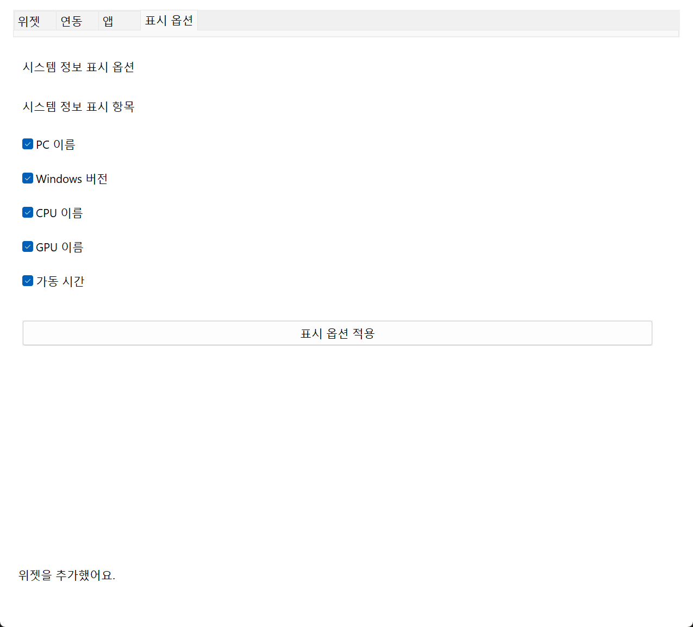](docs/assets/readme-2026-10-17/usage-system-options.png)

### 네트워크 — 다운로드·업로드 속도

현재 수신·송신 속도를 표시하고 넓은 크기에서는 그래프를 함께 볼 수 있습니다. 기본값인 **전체 네트워크**는 연결된 실제 유선·무선 장치의 속도를 합산합니다.

1. 네트워크 위젯을 선택합니다.
2. **네트워크 집계 대상**에서 전체 또는 개별 장치를 고르고 **적용**합니다.
3. 바이트 단위로 보려면 **표시 옵션 → 네트워크 · 바이트 단위 (KiB/s, MiB/s) → 표시 옵션 적용**을 누릅니다.

필터 드라이버·터널 등 가상 인터페이스는 중복 집계를 막기 위해 전체 집계에서 제외합니다. 이 위젯은 현재 전송 속도를 보여주며 인터넷 회선의 최대 속도를 측정하는 도구는 아닙니다.

네트워크 선택과 그래프 설정 보기

[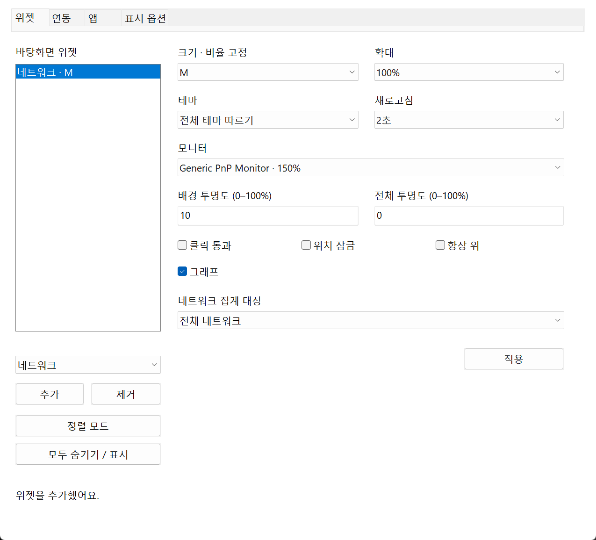](docs/assets/readme-2026-10-17/usage-network.png)

### 디스크 — 드라이브별 남은 공간

[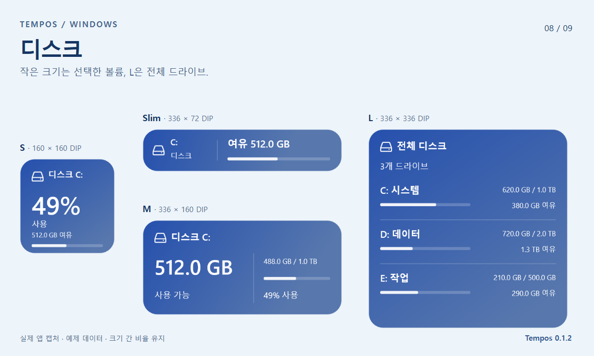](docs/assets/readme-2026-10-17/disk-sizes.png)

**S·Slim·M은 선택한 볼륨**, **L은 전체 로컬 드라이브**를 보여줍니다. 사용량·전체 용량·계정에서 사용할 수 있는 여유 공간을 확인합니다.

1. 디스크 위젯을 선택합니다.
2. S·Slim·M에서는 **볼륨**을 고르고 **적용**합니다. L에서는 볼륨 선택 항목이 나타나지 않습니다.
3. GiB·TiB로 보려면 **표시 옵션 → 디스크 · 이진 단위 (GiB, TiB) → 표시 옵션 적용**을 사용합니다.

L에서 작은 크기로 돌아오면 이전 볼륨 선택을 사용합니다. 드라이브가 7개 이상이면 6개씩 12초마다 다음 목록으로 넘어갑니다. 잠기거나 제거된 볼륨은 조회 불가로 표시하며, 디스크 건강 상태나 SMART 정보는 제공하지 않습니다.

### 캘린더 — 오늘부터 한 달 일정까지

계정을 연결하지 않아도 로컬 달력을 사용할 수 있습니다. S·Slim·M은 날짜와 다가오는 일정을 간단히 보고 L·XL은 월간 달력으로 사용합니다. Google 일정을 표시하려면 [캘린더 연결](#calendar)이 필요합니다.

1. 캘린더 위젯을 선택하고 크기·시간대를 정한 뒤 **적용**합니다.
2. L·XL의 월 이동은 설정창의 **이전 달 / 오늘 / 다음 달**에서 합니다.
3. 월요일부터 보려면 **표시 옵션 → 캘린더 · 월요일부터 한 주 시작 → 표시 옵션 적용**을 누릅니다.

[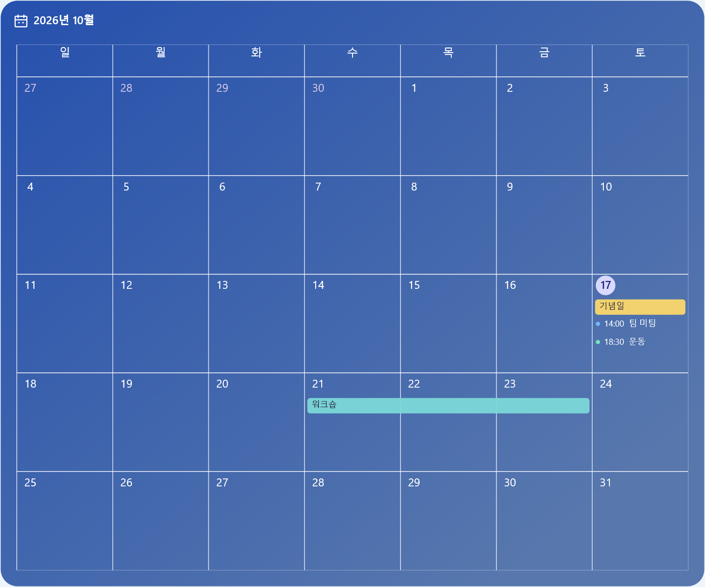](docs/assets/readme-2026-10-17/calendar-xl.png)

XL은 날짜 칸마다 일정을 보여줍니다. 종일·시간·여러 날 일정이 함께 표시되며, 칸에 다 들어가지 않으면 **+N개**로 남은 수를 표시합니다. 위젯에서 일정을 추가·수정·삭제하거나 클릭해 열지는 않습니다.

## 크기·테마·표시 옵션 바꾸기

| 크기 | 기본 크기 | 사용 예 |
| --- | --- | --- |
| **S** | 160 × 160 | 좁은 자리에서 핵심 값 확인 |
| **Slim** | 336 × 72 | 가로로 긴 한 줄 배치 |
| **M** | 336 × 160 | 값과 보조 정보를 함께 확인 |
| **L** | 336 × 336 | 그래프·목록·월간 달력 |
| **XL** | 1008 × 840 | 캘린더 전용 큰 월간 일정 |

크기는 Windows의 논리 화면 단위(DIP)입니다. **확대 100 / 150 / 200%**와 Windows 배율이 함께 반영되므로 실제 화면 픽셀 수는 달라집니다.

| 바꾸려는 것 | 설정 방법 |
| --- | --- |
| 전체 테마 | **앱 → 전체 테마 → 전체 테마 적용** |
| 한 위젯의 테마 | 해당 위젯의 **테마 → 적용**. **전체 테마 따르기**로 공통 테마 사용 |
| 배경만 투명하게 | **배경 투명도 → 적용**. 0%는 불투명, 100%는 배경 투명 |
| 글자·아이콘까지 투명하게 | **전체 투명도 → 적용**. 100%면 보이지 않음 |
| 다른 모니터로 이동 | **모니터 → 적용** |
| 이동 막기 | **위치 잠금 → 적용** |
| 뒤쪽 바탕화면 클릭 | **클릭 통과 → 적용** |
| 일반 창 위에 표시 | **항상 위 → 적용** |

보이지 않을 만큼 투명하게 만든 위젯도 **정렬 모드**에서 찾아 다시 설정할 수 있습니다. 모니터를 분리하면 가능한 화면에 임시로 배치하며 원래 모니터와 저장 위치는 유지합니다.

**표시 옵션**은 **위젯** 탭에서 선택한 대상을 사용합니다. 해당 위젯에 필요한 항목만 나타나므로 먼저 대상을 확인하고 **표시 옵션 적용**을 누르세요.

시계의 12시간 표시 옵션 보기

[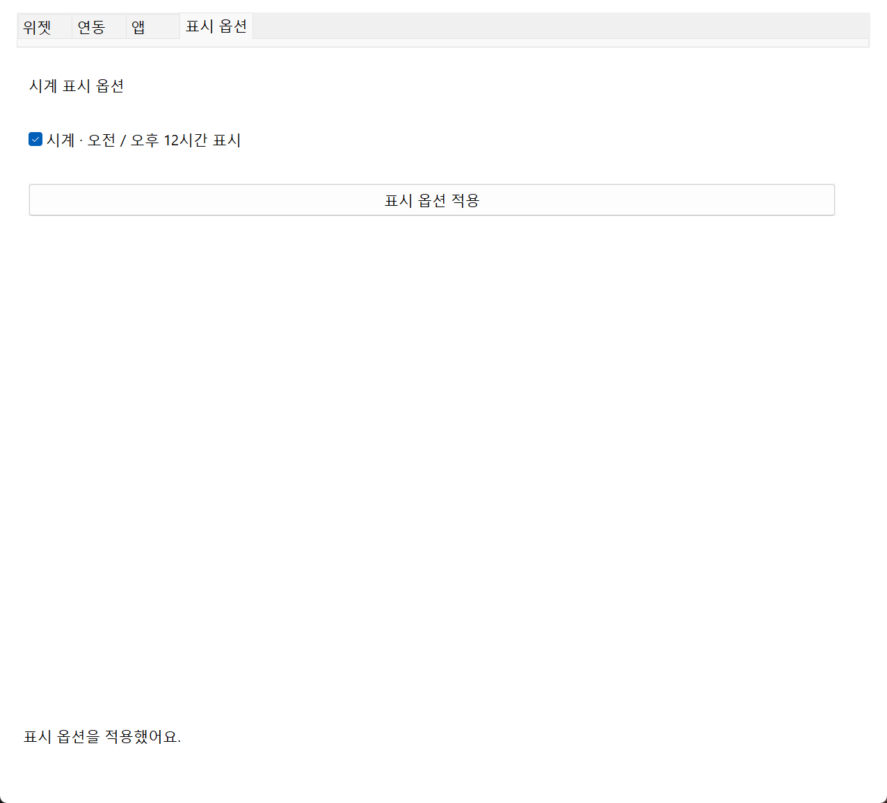](docs/assets/readme-2026-10-17/usage-clock-options.png)

## 날씨 서비스와 지역 설정하기

### 서비스 고르기

| 서비스 | 준비할 것 | 알아둘 점 |
| --- | --- | --- |
| **Open-Meteo** | 인증키 없이 사용 | 신규 설치 기본값. 모델 기반 현재값·예보이며 무료 API는 비상업적 이용용 |
| **기상청** | 본인 API허브 인증키와 이용 권한 | 국내 실황과 예보를 조합해 표시 |

1. **연동 → 날씨 서비스**에서 서비스를 선택합니다.
2. **날씨 서비스 적용**을 누릅니다. 모든 날씨 위젯에 함께 적용됩니다.
3. 기상청을 선택했다면 **기상청 API허브 인증키**를 입력하고 **날씨 인증키 저장**을 누릅니다.

[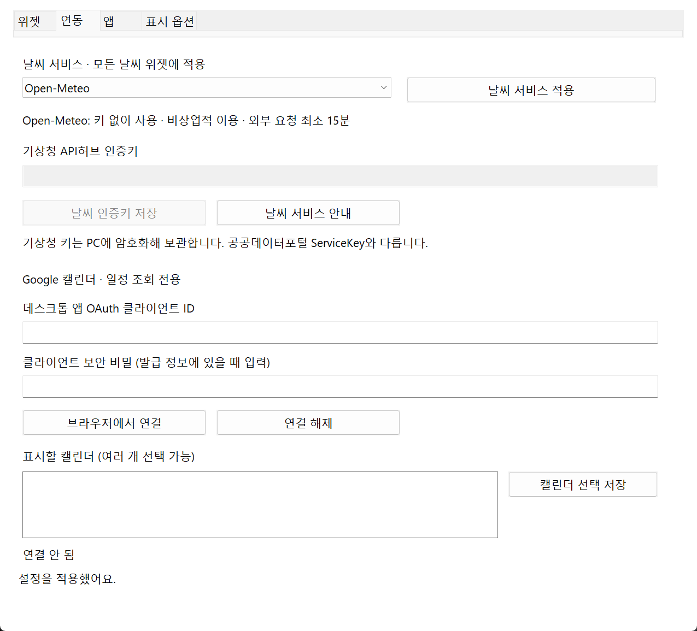](docs/assets/readme-2026-10-17/usage-weather-open-meteo.png)

기상청 키는 [API허브](https://apihub.kma.go.kr/)에서 준비합니다. 공공데이터포털의 `ServiceKey`와 다른 키입니다. Open-Meteo로 바꿔도 저장한 기상청 키는 유지합니다. [Open-Meteo 이용 조건](https://open-meteo.com/en/terms).

기상청 인증키 입력 화면 보기

[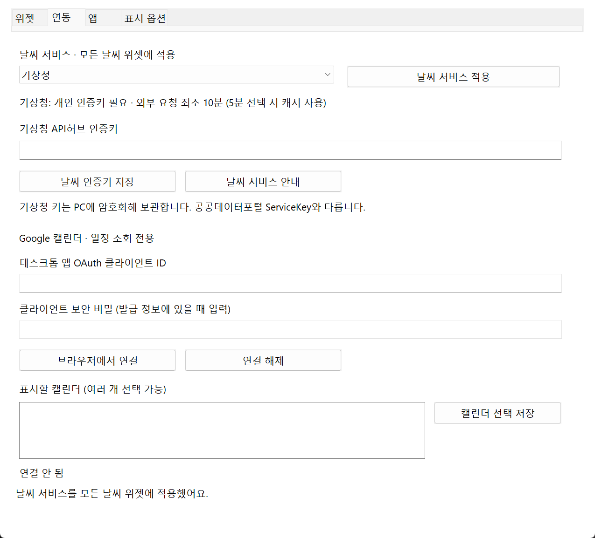](docs/assets/readme-2026-10-17/usage-weather-kma.png)

### 내 지역 선택하기

1. **위젯** 탭에서 날씨 위젯을 선택합니다.
2. **날씨 지역**에서 원하는 국내 지역을 고릅니다.
3. **적용**을 누르고 위젯의 지역 이름을 확인합니다.

[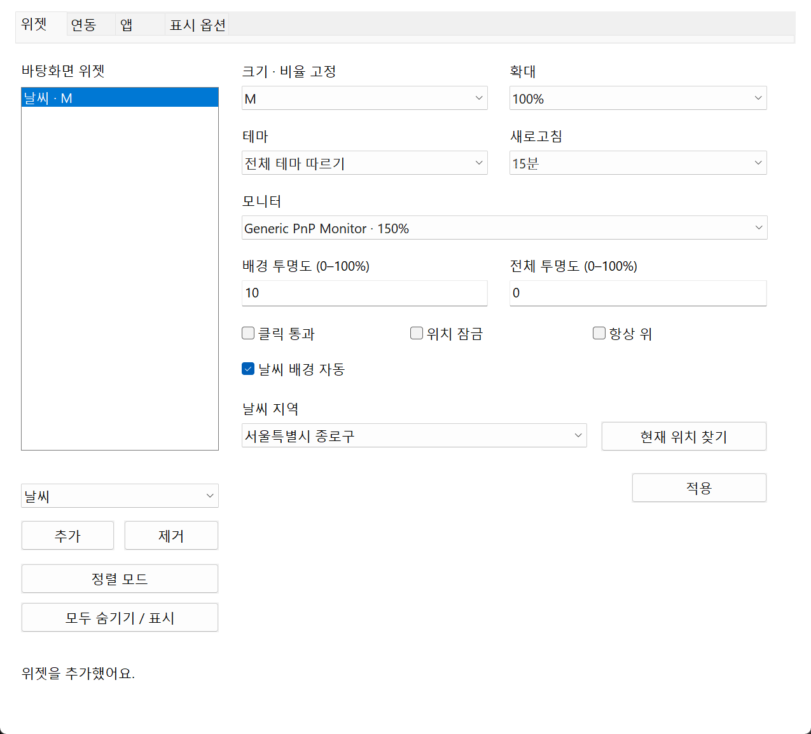](docs/assets/readme-2026-10-17/usage-weather-region.png)

**현재 위치 찾기**는 Windows 위치 기능으로 가까운 국내 지역을 한 번 선택합니다. 결과를 확인한 뒤 **적용**하면 그 지역을 계속 사용하며 자동으로 위치를 추적하지 않습니다. 권한 거부·조회 실패 시에는 기존 지역을 유지합니다. 해외 도시 검색은 제공하지 않습니다.

현재 위치 찾기 후 지역을 적용한 예제

[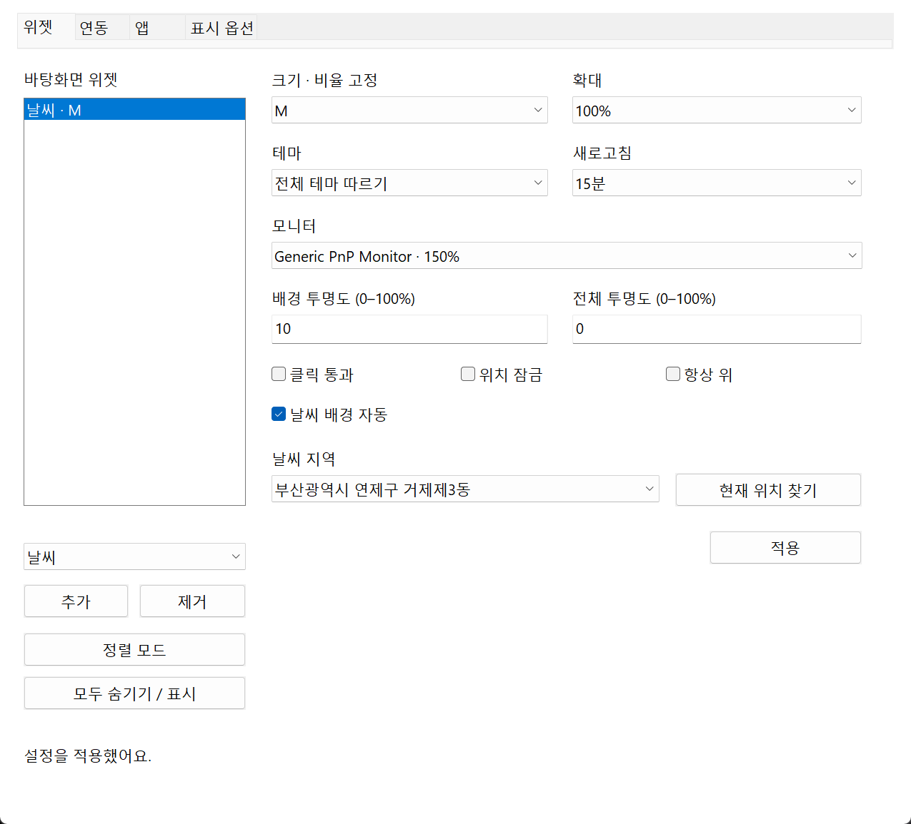](docs/assets/readme-2026-10-17/usage-location-applied.png)

이 화면은 촬영용 부산 좌표를 사용했습니다. 실제 사용자의 위치가 아닙니다.

### 배경과 갱신 이해하기

**날씨 배경 자동**을 켜면 날씨와 낮밤에 맞는 배경을 사용합니다.

| 맑은 낮 | 비 | 맑은 밤 |
| --- | --- | --- |
| [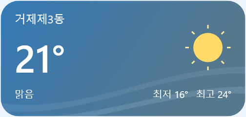](docs/assets/readme-2026-10-17/weather-clear.png) | [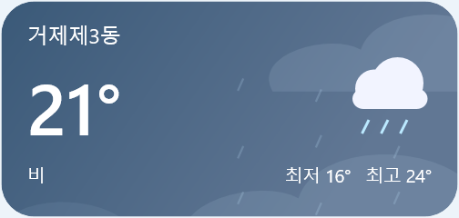](docs/assets/readme-2026-10-17/weather-rain.png) | [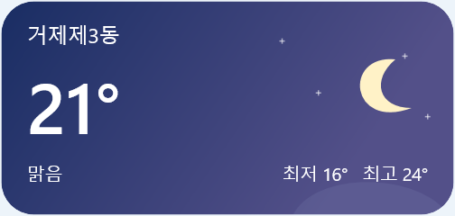](docs/assets/readme-2026-10-17/weather-night.png) |

외부 요청은 기상청 최소 10분, Open-Meteo 최소 15분 간격입니다. 더 짧은 새로고침 주기를 골라도 중간에는 저장한 자료를 사용합니다. 통신 실패 시 최근 자료에 **갱신 지연**을 표시하며 다른 서비스로 자동 전환하지 않습니다.

날씨 요청에는 선택한 지역의 좌표·격자가 해당 서비스로 전달됩니다. 서비스 정보와 상세 동작은 [날씨 안내](docs/weather.md)를 확인하세요.

## Google 캘린더 연결하기

로컬 달력만 필요하면 이 절차를 건너뛰어도 됩니다. Google 연결은 **일정 조회 전용**이며 본인의 Google 계정과 데스크톱 앱 OAuth 발급 정보가 필요합니다.

1. Google Cloud 프로젝트에서 **Google Calendar API**를 사용 설정합니다.
2. OAuth 동의 화면을 구성하고 **데스크톱 앱** 유형의 OAuth 클라이언트를 만듭니다. 테스트 상태라면 사용할 계정을 테스트 사용자로 등록합니다.
3. Tempos의 **연동** 탭에 **데스크톱 앱 OAuth 클라이언트 ID**를 입력합니다. 발급 정보에 보안 비밀이 있으면 **클라이언트 보안 비밀**에도 입력합니다.
4. **브라우저에서 연결**을 누르고 본인 계정으로 승인합니다.
5. 앱에 돌아와 **표시할 캘린더**를 선택한 뒤 **캘린더 선택 저장**을 누릅니다. 여러 개는 Ctrl을 누른 채 선택할 수 있습니다.
6. 캘린더 위젯에서 일정을 확인합니다.

발급 과정은 [Google 공식 데스크톱 앱 연결 안내](https://developers.google.com/identity/protocols/oauth2/native-app)를 참고하세요.

[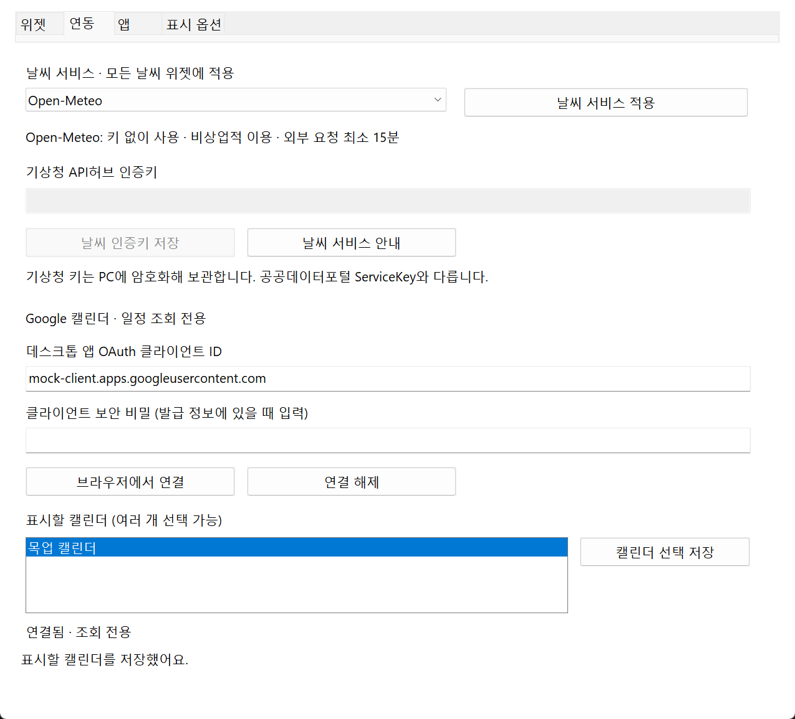](docs/assets/readme-2026-10-17/usage-calendar-connected.png)

촬영용 목업 연결 화면입니다. 실제 Google 로그인·동의 화면은 포함하지 않았습니다.

[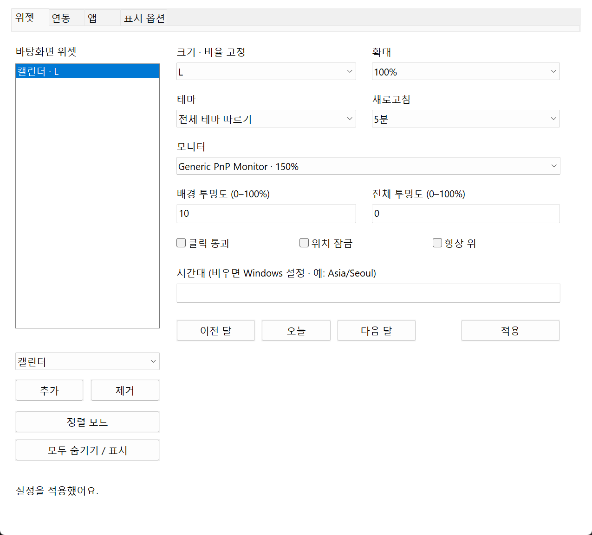](docs/assets/readme-2026-10-17/usage-calendar-month.png)

연결이 풀리면 프로젝트의 테스트 상태, 토큰 만료, 계정 권한을 확인하고 다시 연결하세요. **연결 해제**는 이 PC의 토큰과 저장된 일정 자료를 지웁니다. Google 계정 쪽의 접근 권한 철회는 Google 계정 설정에서 별도로 할 수 있습니다.

## CPU 온도 켜기

1. **앱** 탭을 엽니다.
2. **CPU 온도 표시 · 처음에는 센서 도우미 설치 필요**를 켭니다.
3. 도우미가 없다면 센서 설치 프로그램의 관리자 승인을 진행합니다.
4. 설치 완료와 설정 상태를 확인한 뒤 CPU 위젯에서 온도를 확인합니다.

[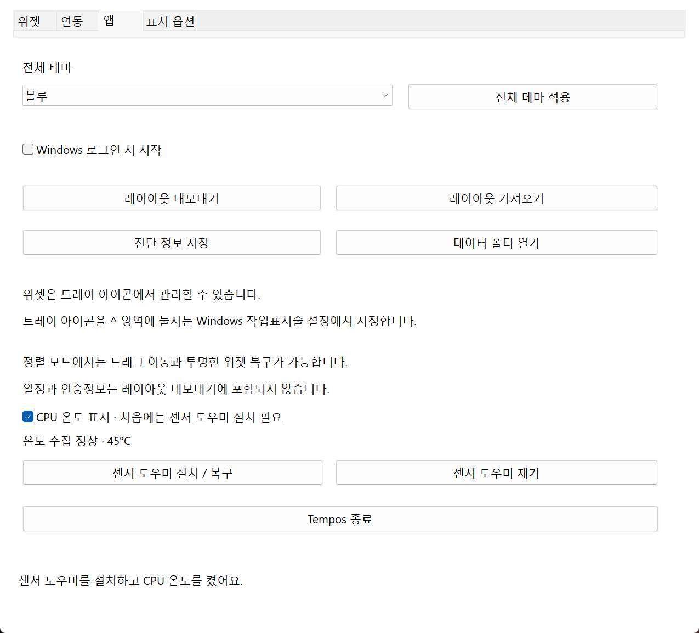](docs/assets/readme-2026-10-17/usage-cpu-temperature.png)

이 화면의 설치 성공과 온도는 예제입니다. 촬영 중 실제 서비스나 드라이버를 설치하지 않았습니다.

설치 성공과 서비스 실행이 확인돼야 온도 표시가 켜집니다. 취소·실패하면 기존 설정을 유지합니다. 재시작 안내가 나오면 Windows를 재시작한 뒤 다시 켜세요. 다음 실행부터는 저장한 설정을 사용합니다.

문제가 있으면 **센서 도우미 설치 / 복구**를 사용합니다. **센서 도우미 제거**는 CPU 온도 표시도 끄며 다른 프로그램이 사용할 수 있는 공유 PawnIO 드라이버는 남겨 둡니다. GPU 온도는 이 도우미와 관계없이 Windows·드라이버 지원 여부에 따릅니다.

### 숫자 색상과 빈 값

| 항목 | 주황색부터 | 빨간색부터 |
| --- | --- | --- |
| CPU·GPU 온도 | 80°C | 90°C |
| CPU·GPU 사용률 | 80% | 95% |
| 메모리·디스크 사용률 | 80% | 90% |

색은 높은 값을 쉽게 찾기 위한 앱의 표시 기준입니다. 기기별 최대 허용 온도나 고장 여부를 판정하는 기준은 아닙니다.

꺼짐·측정 중·미지원·연결 실패·오래된 온도는 `—`로 표시합니다. CPU의 상세 상태는 **앱** 탭에서 확인하세요. [지원 범위와 센서 안내](docs/sensors.md).

## Windows 로그인 시 자동 시작하기

1. **앱 → Windows 로그인 시 시작**을 체크합니다.
2. 별도의 적용 버튼 없이 바로 저장됩니다.
3. 다음 Windows 로그인 때 Tempos가 실행됩니다.

[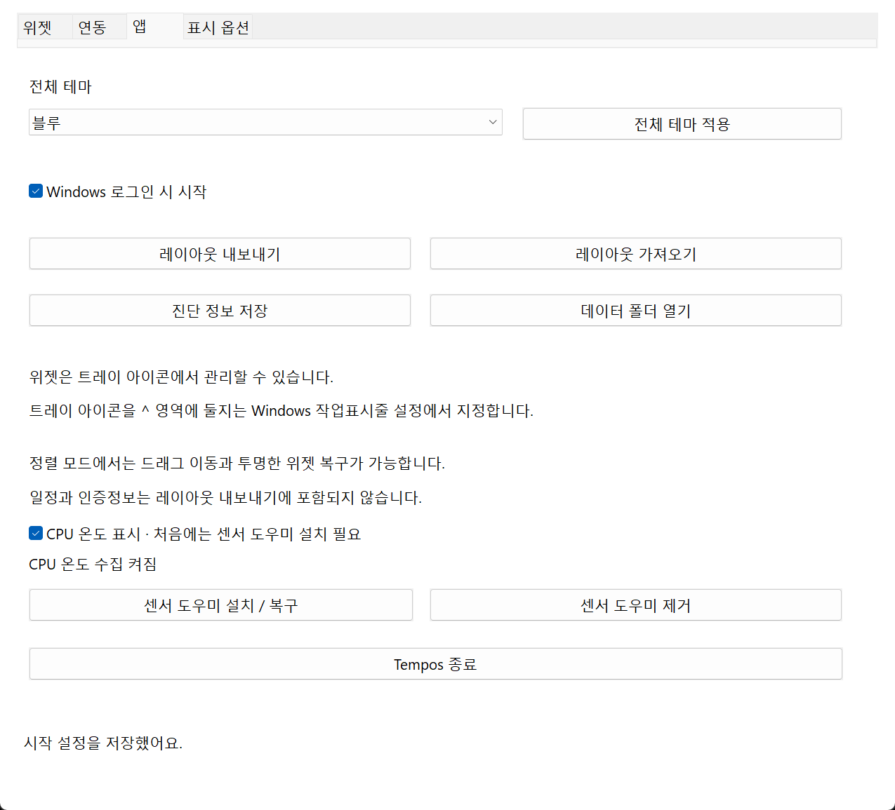](docs/assets/readme-2026-10-17/usage-app-startup.png)

앱을 종료해도 이 옵션은 유지됩니다. 자동 시작을 끄려면 체크를 해제하세요. Windows의 시작 앱 설정에서 차단했다면 Windows 쪽 상태도 확인합니다.

ZIP 폴더를 옮기거나 ZIP에서 설치형으로 바꾼 경우 새 위치에서 옵션을 껐다가 켜서 등록 경로를 갱신하세요.

## 백업·복원·기기 변경하기

### 레이아웃 파일 저장하기

1. **앱 → 레이아웃 내보내기**를 누릅니다.
2. JSON 파일의 저장 위치와 이름을 정합니다.
3. 완료 안내를 확인하고 파일을 보관합니다.

[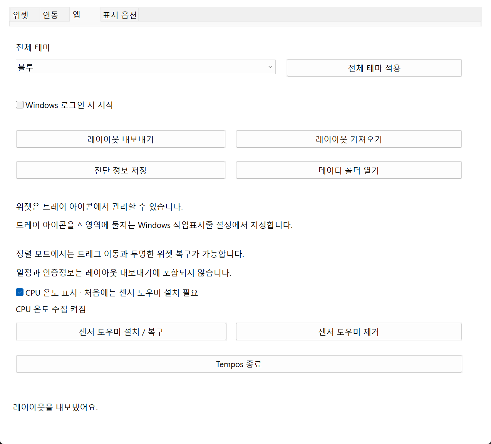](docs/assets/readme-2026-10-17/usage-backup-exported.png)

### 복원하거나 다른 PC로 옮기기

1. 대상 PC에 Tempos를 준비합니다. 현재 배치도 보관하려면 먼저 내보내세요.
2. **앱 → 레이아웃 가져오기**에서 저장한 JSON 파일을 선택합니다.
3. 현재 위젯 구성·테마·날씨 서비스 선택이 가져온 내용으로 교체됩니다. 위젯은 표시 상태로 열립니다.
4. 모니터 배치를 확인하고 필요한 날씨·Google 연결과 CPU 온도 설정을 준비합니다.

| 레이아웃에 들어가는 것 | 들어가지 않는 것 |
| --- | --- |
| 위젯 종류·크기·위치·개별 설정, 전체 테마, 날씨 서비스 선택 | 인증키·Google 인증 정보·일정 캐시, 자동 시작 등록, 전체 숨김 상태, PC별 CPU 온도 활성화 설정 |

CPU 온도 활성화는 가져오기 후에도 해당 PC의 기존 설정을 유지합니다. 다른 PC·Windows 사용자로 옮길 때 인증 파일 복사만으로 연결을 복구할 수는 없습니다.

설정은 `%LocalAppData%\Tempos`에 저장합니다. **앱 → 데이터 폴더 열기**에서 확인하세요. 정상 설정의 직전 사본도 자동 보관하지만 다른 기기와 자동 동기화하는 기능은 아닙니다. [저장·복구 상세 안내](docs/user-guide.md#저장과-복구).

## 업데이트와 제거

### 업데이트하기

1. [최신 다운로드](https://github.com/poyal/tempos/releases/latest)에서 변경 사항과 파일을 확인합니다.
2. **Tempos 종료**로 앱을 완전히 종료합니다.
3. 설치형은 새 EXE를 실행해 기존 설치 폴더에 설치합니다. ZIP은 압축을 모두 풀어 실행 파일·data 폴더·함께 배포된 구성요소를 교체합니다.
4. Tempos를 다시 실행하고 저장된 위젯 배치를 확인합니다.

설정은 설치 폴더와 별도로 저장하므로 같은 Windows 사용자로 실행하면 유지됩니다. 업데이트 전 [레이아웃을 내보내면](#backup) 배치를 별도 파일로 보관할 수 있습니다.

### 앱 제거하기

Tempos를 종료한 뒤 **Windows 설정 → 앱 → 설치된 앱 → Tempos → 제거**를 사용합니다. 설치 폴더의 **Uninstall Tempos.exe**로도 제거할 수 있습니다.

앱·바로가기·해당 설치본의 자동 시작 등록은 제거하며 저장된 위젯 설정과 연동 정보는 유지합니다. CPU 센서 도우미의 제거 여부는 별도로 선택합니다. 설치 폴더를 바꾸려면 기존 설치를 제거한 뒤 새 위치에 설치하세요.

## 막혔을 때 확인하기

| 상황 | 확인할 내용 |
| --- | --- |
| 설정창을 닫아도 위젯이 남아 있습니다 | X는 설정창만 닫습니다. **앱 → Tempos 종료**로 종료하세요. |
| 트레이 아이콘이 보이지 않습니다 | 작업표시줄 **^**를 확인하거나 시작 메뉴에서 Tempos를 다시 여세요. |
| 재실행했는데 위젯이 보이지 않습니다 | **모두 숨기기 / 표시**, 전체 투명도, 모니터·화면 공간을 확인하고 **정렬 모드**를 켜세요. |
| 위젯을 움직일 수 없습니다 | **정렬 모드**와 대상의 **위치 잠금** 해제 여부를 확인하세요. |
| 위젯이 추가되지 않거나 크기가 바뀌지 않습니다 | 화면 공간을 확보하거나 크기·확대를 줄이세요. 최대 64개입니다. |
| 설정이 저장되지 않습니다 | **적용** 또는 **표시 옵션 적용**, 저장 실패 안내와 데이터 폴더 권한을 확인하세요. |
| 날씨가 나오지 않습니다 | 서비스 선택·인터넷 연결을 확인하세요. 기상청에는 본인의 API허브 키가 필요합니다. |
| 날씨에 갱신 지연이 표시됩니다 | 통신 오류·요청 제한 중 최근 자료를 보여주는 상태입니다. 서비스와 네트워크를 확인하세요. |
| 현재 위치를 찾지 못합니다 | Windows 위치 권한을 확인하거나 **날씨 지역**을 직접 선택하세요. |
| CPU 온도가 `—`로 보입니다 | **앱** 탭의 온도 설정·상태와 센서 도우미를 확인하세요. 미지원 센서에는 값이 나오지 않습니다. |
| GPU 온도·장치 정보가 없습니다 | 선택한 GPU와 Windows·드라이버의 지원 여부를 확인하세요. |
| 캘린더에 일정이 없습니다 | 로컬 달력만 사용 중인지, 연결 후 **캘린더 선택 저장**까지 했는지 확인하세요. |
| Google 연결이 풀렸습니다 | 토큰 만료·권한 철회·프로젝트 테스트 상태를 확인하고 다시 연결하세요. |
| 자동 시작이 되지 않습니다 | 앱의 체크 상태, Windows 시작 앱 허용, 실행 파일의 등록 위치를 확인하세요. |

문제를 알릴 때는 사용 버전, Windows 환경, 재현 순서와 오류 문구를 함께 남겨 주세요. **앱 → 진단 정보 저장**을 누르면 데이터 폴더의 `diagnostics.json`에 창 배치·모니터·수집 상태가 기록됩니다. 인증키나 일정 제목은 포함하지 않습니다.

진단 정보 저장 화면 보기

[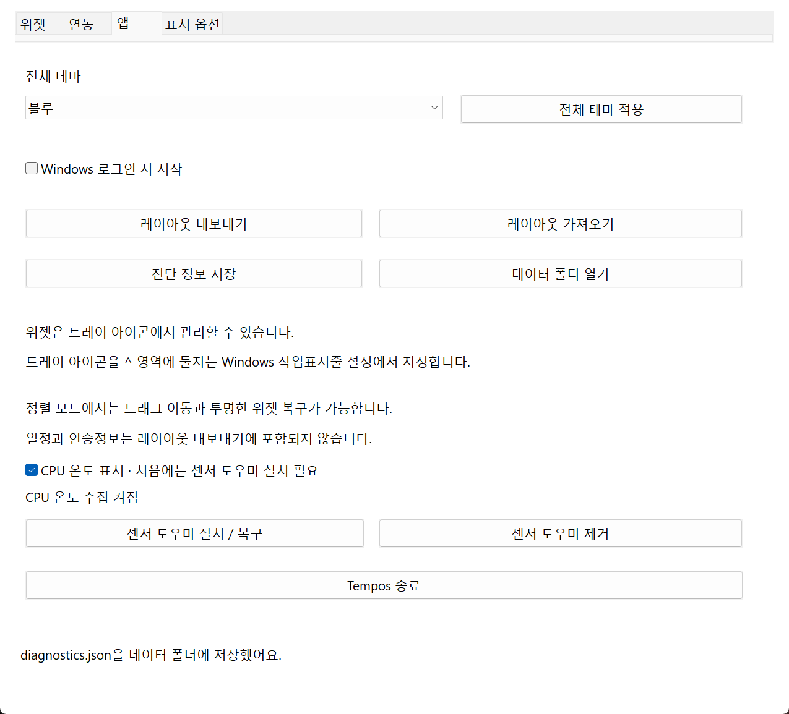](docs/assets/readme-2026-10-17/usage-diagnostics.png)

화면을 첨부할 때는 개인 일정·계정·인증키·PC 이름을 확인해 가려 주세요.

## 문서와 문의

- [상세 사용 안내](docs/user-guide.md) · [날씨 서비스](docs/weather.md) · [CPU·GPU 온도](docs/sensors.md)
- [전체 화면과 촬영 조건](docs/screenshots.md) · [최신 화면 촬영·검증 기록](docs/validation/2026-10-17-readme.md)
- [0.1.2 릴리즈 노트](docs/releases/v0.1.2.md) · [개발 안내](docs/development.md) · [E2E 안내](docs/e2e.md)
- [검증 기록](docs/verification.md) · [레이아웃 변경 보고서](docs/validation/2026-10-17-layout-report.html) · [문서 모음](docs/README.md) · [외부 구성요소 고지](THIRD_PARTY_NOTICES.md)

제작자 **Poyal** · [GitHub](https://github.com/poyal/tempos) · [문의·오류 신고](https://github.com/poyal/tempos/issues)
