# Tempos 사용자 매뉴얼

Tempos는 Windows 11 x64 바탕화면에 시계, 날씨, 시스템 사용량과 캘린더를 놓는 앱입니다. Tempos 계정이나 관리자 권한, .NET 설치 없이 사용할 수 있습니다. 설정은 PC의 `%LocalAppData%\Tempos`에 저장합니다.

처음 사용하시면 **ZIP 압축 풀기 → 실행 → 트레이에서 설정 열기 → 위젯 배치 → 날씨 서비스 선택** 순서로 진행하세요.

[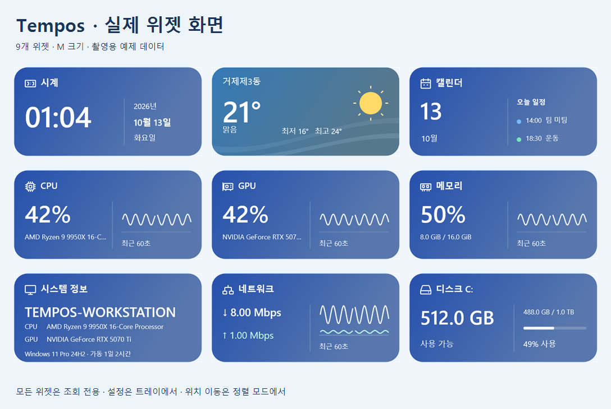](docs/assets/widgets-overview.png)

실제 앱의 위젯을 촬영용 예제 데이터로 실행한 화면입니다. 개인 계정·위치·실시간 측정값은 사용하지 않았습니다. 이미지를 누르면 크게 볼 수 있습니다. [크기별 화면과 촬영 조건](docs/screenshots.md).

아래는 **배포 실행 파일에서 실제 Windows 메모리·네트워크 사용량을 수집한 화면**입니다. Windows 11에서 ZIP을 새로 풀어 검증했으며, 실제 수집에서 발견한 메모리 그래프 누락도 수정했습니다. [실행 결과와 전체 실측 화면](docs/validation/windows-2026-10-13/README.md).

<table>
  <tr><th>실제 메모리 사용량</th><th>실제 전체 네트워크</th></tr>
  <tr>
    <td>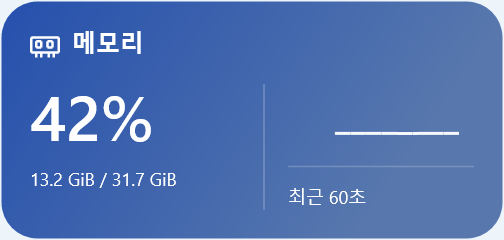</td>
    <td>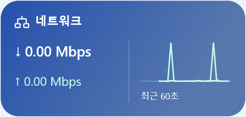</td>
  </tr>
</table>

[설치](#install) · [화면과 종료](#window) · [위젯 배치](#widgets) · [표시 설정](#appearance) · [날씨](#weather) · [캘린더](#calendar) · [자동 시작](#startup) · [백업·업데이트](#backup) · [문제 해결](#help)

## 설치하고 실행하기

1. 받은 `Tempos-<버전>-win-x64.zip`을 계속 사용할 폴더에 풉니다.
2. **Tempos.exe**를 실행합니다. 실행 파일과 함께 들어 있는 **data** 폴더를 유지하세요.
3. 바탕화면에 기본 위젯 다섯 개가 나타납니다. 작업표시줄 알림 영역의 **Tempos 아이콘**을 누르면 설정이 열립니다.

현재는 ZIP을 풀어 실행하는 방식입니다. 앱 폴더를 옮겼다면 아래의 Windows 자동 시작 설정도 다시 등록하세요.

## 화면과 종료 방법 익히기

| 위치 | 하는 일 |
| --- | --- |
| **위젯** | 위젯 추가·제거, 크기·위치·투명도·지역·장치 설정 |
| **연동** | 날씨 서비스 선택, 기상청 인증키 저장, Google 캘린더 연결 |
| **앱** | 전체 테마, Windows 자동 시작, 레이아웃 백업, 데이터 폴더, 앱 종료 |
| **표시 옵션** | 선택한 위젯의 시간·온도·용량 단위와 시스템 정보 항목 |

- 설정창의 **X**는 설정창만 닫습니다. 위젯은 계속 실행됩니다.
- 완전히 종료하려면 **앱 → Tempos 종료** 또는 트레이 메뉴의 종료 항목을 사용하세요.
- 다시 실행하면 적용해 저장한 위젯 구성과 설정을 불러옵니다. 적용하지 않은 입력값은 저장되지 않습니다.
- 트레이 아이콘이 안 보이면 작업표시줄의 **^**를 확인하세요. 아이콘을 항상 보이게 하는 것은 Windows 작업표시줄 설정에서 지정합니다.
- 위젯 본체는 조회 전용이며 클릭·더블클릭·우클릭으로 창이나 메뉴를 열지 않습니다. 설정은 트레이에서 열고, 위치는 정렬 모드에서 드래그해 바꿉니다.

## 위젯을 추가하고 배치하기

1. **위젯** 탭에서 추가할 종류를 고르고 **추가**를 누릅니다.
2. 왼쪽 목록에서 위젯을 선택합니다.
3. 크기, 확대, 모니터 등 원하는 값을 고른 뒤 **적용**을 누릅니다.
4. **정렬 모드**를 켜고 바탕화면의 위젯을 드래그합니다. 배치가 끝나면 정렬 모드를 끕니다.

같은 종류도 여러 개 만들 수 있으며 최대 64개까지 저장합니다. 화면에 놓을 공간이 없으면 추가나 크기 변경이 적용되지 않습니다. 크기를 줄이거나 기존 위젯을 옮겨 공간을 확보하세요.

| 종류 | 표시 정보 |
| --- | --- |
| 시계 | 모든 크기에서 선택한 시간대의 디지털 날짜와 시간 |
| 날씨 | 선택한 국내 지역의 날씨, 최저·최고, 시간별 예보 |
| CPU / GPU / 메모리 | 사용량과 지원되는 그래프 |
| 시스템 정보 | PC·OS·CPU·GPU·가동 시간 |
| 네트워크 | 전체 네트워크 또는 선택한 어댑터의 수신·송신 속도 |
| 디스크 | S/Slim/M은 선택 볼륨, L은 전체 로컬 볼륨의 용량과 여유 공간 |
| 캘린더 | 달력, 연결한 캘린더의 읽기 전용 일정 |

**네트워크:** 기본값인 **전체 네트워크**는 연결된 유선·무선 장치의 수신·송신을 합산합니다. 필터 드라이버·터널 등 가상 인터페이스는 중복 집계를 막기 위해 제외합니다. **네트워크 집계 대상**에서 개별 장치를 선택할 수도 있습니다.

**디스크:** S/Slim/M은 위젯을 선택한 뒤 **볼륨**을 지정하고 **적용**하세요. L은 전체 로컬 볼륨을 표시하므로 볼륨 선택 필드가 나타나지 않습니다. 작은 크기로 돌아가면 이전 선택을 사용합니다. 7개 이상이면 6개씩 12초마다 다음 목록으로 넘어갑니다. 잠기거나 제거된 볼륨은 조회 불가로 표시합니다.

<table>
  <tr><th>선택한 디스크 · M</th><th>전체 디스크 · L</th><th>시스템 사양 · L</th></tr>
  <tr>
    <td valign="top"><a href="docs/assets/final-disk-single.png">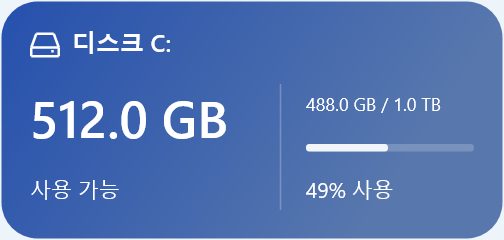</a></td>
    <td valign="top"><a href="docs/assets/final-disk-all.png">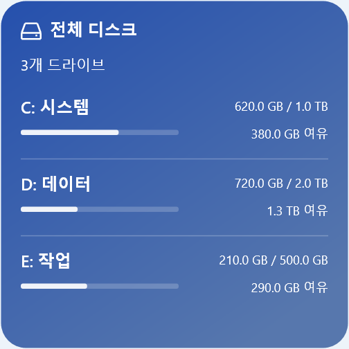</a></td>
    <td valign="top"><a href="docs/assets/final-system.png">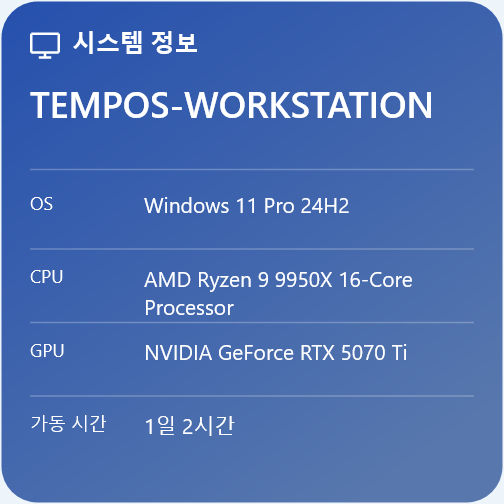</a></td>
  </tr>
</table>

설정에는 선택한 위젯에 필요한 항목만 표시합니다. CPU·GPU·메모리는 같은 사용률·그래프 구성을 사용하며, L에서는 최근 60초의 평균과 최대도 확인합니다.

**제거:** 목록에서 대상 위젯을 선택하고 **제거**를 누릅니다. 다른 위젯은 유지됩니다.

**숨김:** **모두 숨기기 / 표시**를 누르면 전체 위젯을 숨길 수 있습니다. 이 상태도 저장되므로 재실행 후 보이지 않으면 다시 표시하세요.

## 크기와 표시 옵션 바꾸기

| 크기 | 기본 크기 (DIP) |
| --- | --- |
| S | 160 × 160 |
| Slim | 336 × 72 |
| M | 336 × 160 |
| L | 336 × 336 |
| XL — 캘린더 전용 | 1008 × 840 |

확대는 **100 / 150 / 200%**를 지원합니다. Windows 배율도 반영되므로 화면의 실제 픽셀 크기는 달라질 수 있습니다.

- **테마:** **앱 → 전체 테마 → 전체 테마 적용**으로 공통 테마를 바꿉니다. 개별 위젯의 테마를 지정하면 해당 위젯은 그 값을 사용합니다.
- **배경 투명도:** 카드 배경을 투명하게 합니다. **전체 투명도**는 글자와 아이콘까지 포함합니다. 100%로 숨긴 위젯도 정렬 모드에서 찾을 수 있습니다.
- **위치 잠금:** 드래그 이동을 막습니다. **클릭 통과**는 위젯 뒤의 바탕화면을 클릭할 때 사용합니다.
- **표시 옵션:** 먼저 위젯을 선택하고 **표시 옵션** 탭에서 값을 바꾼 뒤 **표시 옵션 적용**을 누릅니다. 12시간제, 화씨, 네트워크 바이트 단위, 디스크 이진 단위, 월요일 시작과 시스템 정보 항목을 설정할 수 있습니다.

모니터가 연결되지 않으면 가능한 화면에 임시로 배치합니다. 원래 모니터와 저장 위치는 유지합니다.

<table>
  <tr><th>시계 설정</th><th>네트워크 설정</th></tr>
  <tr>
    <td><a href="docs/assets/final-settings-clock.png">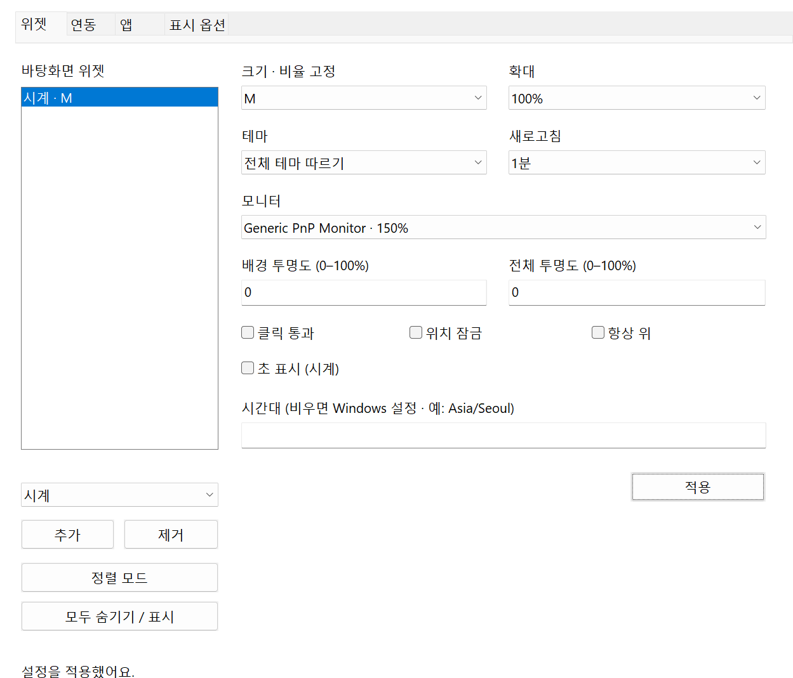</a></td>
    <td><a href="docs/assets/final-settings-network.png">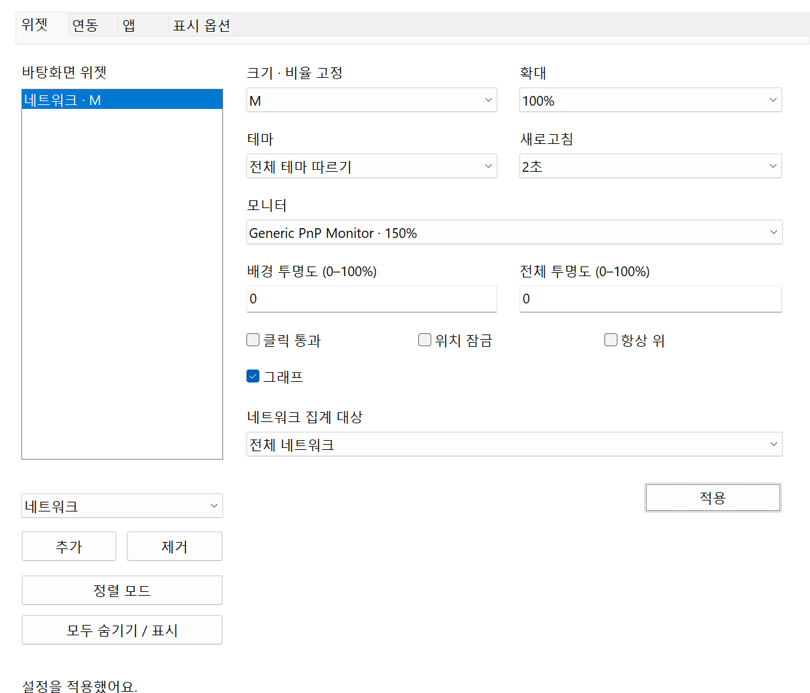</a></td>
  </tr>
</table>

## 날씨 서비스와 지역 선택하기

날씨 서비스는 **모든 날씨 위젯에 공통 적용**됩니다. 지역은 위젯마다 따로 선택합니다.

| 서비스 | 준비할 것 | 사용 조건 |
| --- | --- | --- |
| **Open-Meteo** | 인증키 없이 사용 | 무료 API는 비상업적 이용에 제공됩니다. 모델 기반 현재값·예보입니다. |
| **기상청** | 본인 기상청 API허브 인증키 | 국내 실황·예보를 조합해 표시합니다. |

1. **연동 → 날씨 서비스**에서 원하는 서비스를 선택합니다.
2. **날씨 서비스 적용**을 누릅니다. 선택한 서비스는 연동 탭에서 확인합니다.
3. **위젯** 탭에서 날씨 위젯을 선택합니다.
4. **날씨 지역**에서 국내 지역을 고르고 **적용**을 누릅니다.

**현재 위치 찾기**를 누르면 Windows 위치 기능으로 가까운 국내 지역을 한 번 선택합니다. **적용**하면 해당 지역을 계속 사용하며 위치를 자동 추적하지 않습니다. 위치 권한이 없거나 조회에 실패하면 기존 선택을 유지합니다.

[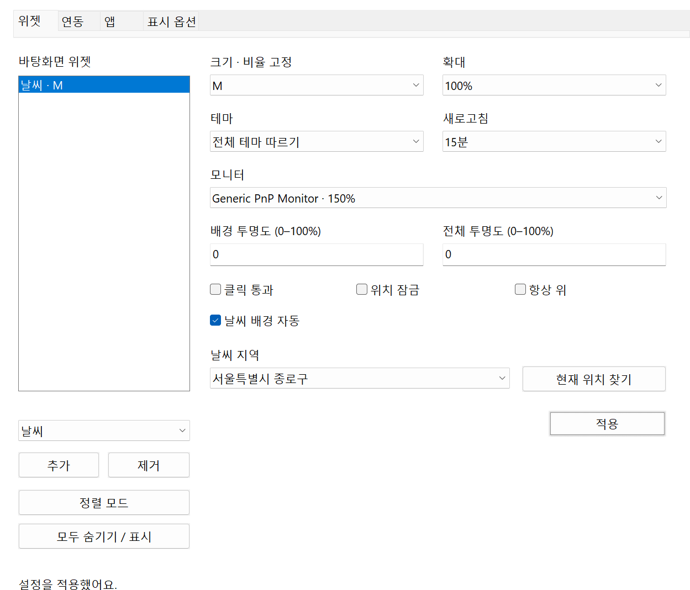](docs/assets/final-settings-weather.png)

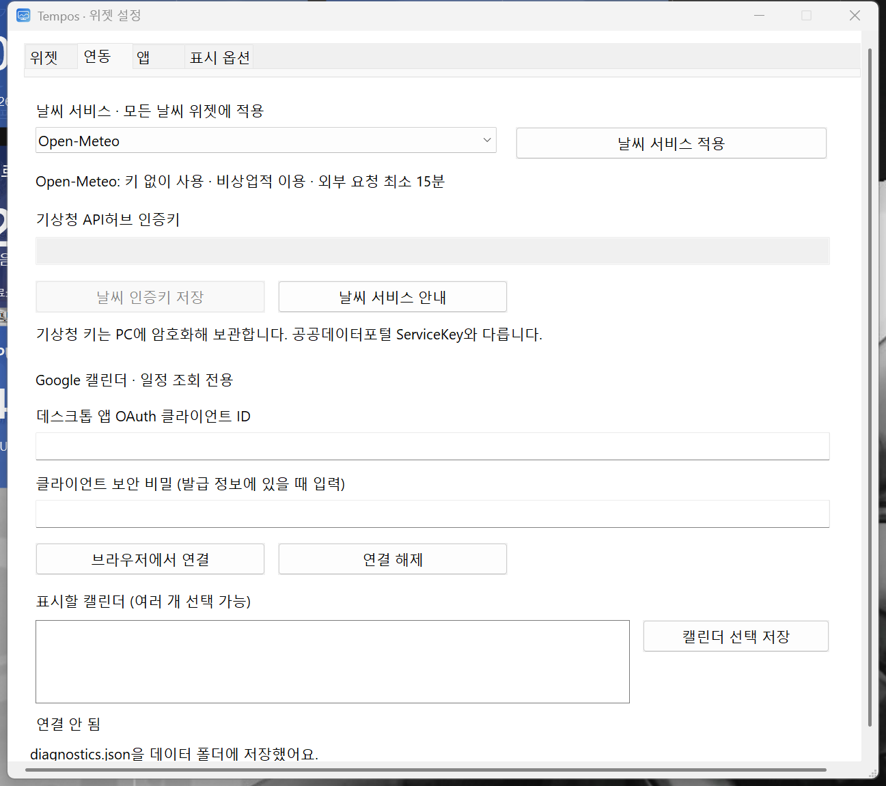

*격리된 테스트 앱의 예제 화면입니다. 실제 개인 계정이나 인증키를 사용하지 않았습니다.*

처음 설치하면 **Open-Meteo**를 사용합니다. 예전 설정으로 업데이트하면 **기상청** 선택을 유지합니다. 공급자를 바꿔도 저장한 기상청 키와 위젯 배치는 보존됩니다.

**기상청 연결:** [API허브](https://apihub.kma.go.kr/)에서 본인 인증키를 발급받은 뒤, 기상청을 선택·적용하고 **기상청 API허브 인증키 → 날씨 인증키 저장**을 사용하세요. 공공데이터포털의 `ServiceKey`와는 다른 키입니다.

외부 요청은 기상청 최소 10분, Open-Meteo 최소 15분 간격입니다. 더 짧은 갱신 주기를 선택해도 중간에는 캐시를 사용합니다. 통신 실패 시 같은 서비스의 최근 자료에 갱신 지연을 표시하며 다른 서비스로 자동 전환하지 않습니다.

**날씨 배경 자동**은 날씨·낮밤에 따라 색과 구름·강수·별 등의 배경을 바꿉니다. 끄면 고정 테마를 사용합니다. 위젯에는 출처 문구를 표시하지 않으며, 서비스 정보와 링크는 **연동** 탭과 [날씨 안내](docs/weather.md)에서 확인할 수 있습니다. [Open-Meteo 무료 이용 조건](https://open-meteo.com/en/terms)

<table>
  <tr><th>맑은 낮</th><th>비 오는 날</th><th>맑은 밤</th></tr>
  <tr>
    <td><a href="docs/assets/final-weather-clear.png">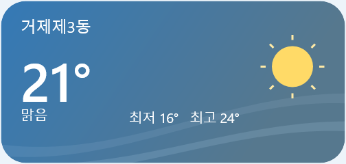</a></td>
    <td><a href="docs/assets/final-weather-rain.png">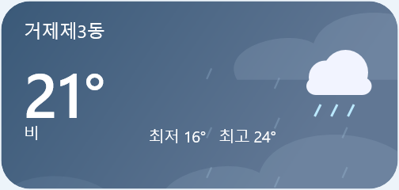</a></td>
    <td><a href="docs/assets/final-weather-night.png">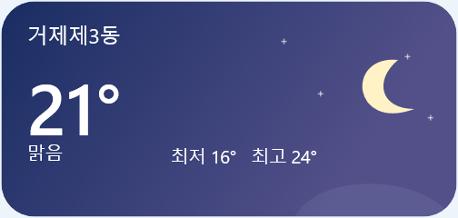</a></td>
  </tr>
</table>

## Google 캘린더 연결하기

연결하지 않아도 로컬 달력을 사용할 수 있습니다. Google 일정은 조회만 지원하며 추가·수정·삭제하거나 참석 응답을 보내지 않습니다.

1. Google Cloud 프로젝트에서 Calendar API를 사용 설정하고 **데스크톱 앱** OAuth 클라이언트를 만듭니다.
2. **연동** 탭에 발급받은 **클라이언트 ID**와 **클라이언트 보안 비밀**을 입력합니다.
3. **브라우저에서 연결**을 누르고 Google 승인 화면을 완료합니다.
4. 표시할 캘린더를 선택한 뒤 **캘린더 선택 저장**을 누릅니다.
5. 일정은 캘린더 위젯에서 확인합니다. L/XL의 월 이동은 **위젯** 탭에서 **이전 달 / 오늘 / 다음 달**을 사용하세요.

[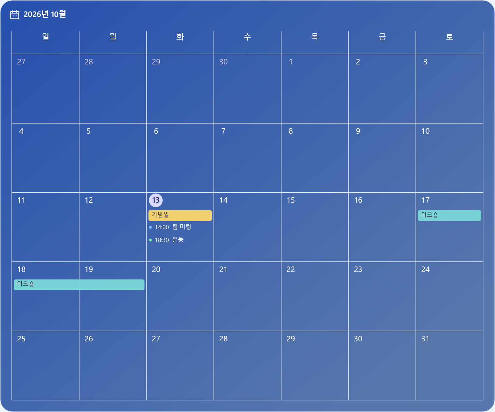](docs/assets/final-calendar-month.png)

예제의 **기념일**은 종일 일정, **워크숍**은 여러 날에 걸친 일정입니다. 날짜 칸에 담기지 않는 일정은 **+N개**로 표시합니다.

Testing 상태의 Google 프로젝트는 테스트 사용자 등록과 토큰 만료 조건을 확인하세요. **연결 해제**는 PC의 토큰과 일정 캐시를 지웁니다. Google 계정의 접근 권한 철회는 계정 설정에서 따로 할 수 있습니다. [Google 공식 연결 안내](https://developers.google.com/identity/protocols/oauth2/native-app)

## Windows 로그인 시 자동 실행하기

1. **앱** 탭을 엽니다.
2. **Windows 로그인 시 시작**을 체크합니다. 별도의 적용 버튼 없이 바로 저장됩니다.
3. 다음 Windows 로그인 때 등록된 위치의 Tempos가 실행됩니다.

앱을 완전히 종료해도 이 옵션은 유지됩니다. 체크를 해제해도 위젯 설정은 지워지지 않습니다. Windows 시작 앱 설정에서 실행을 차단한 경우에는 Windows 쪽 상태도 확인하세요.

실행 파일을 다른 폴더로 옮긴 경우 새 위치에서 옵션을 껐다가 다시 켜 등록 경로를 갱신합니다.

## 백업하고 업데이트하기

**레이아웃 백업**

1. **앱 → 레이아웃 내보내기**를 누르고 JSON 파일을 저장합니다.
2. 복원할 때 **레이아웃 가져오기**를 누르고 저장한 파일을 선택합니다.
3. 가져오기는 현재 위젯 구성·테마·날씨 서비스 선택을 교체합니다. 가져온 위젯은 표시 상태로 열립니다.

레이아웃에는 위젯별 설정과 날씨 서비스 선택이 들어갑니다. 인증키, Google 인증 정보, 일정 캐시, 자동 시작 등록과 숨김 상태는 포함하지 않습니다. 다른 PC나 Windows 사용자에서는 필요한 서비스를 다시 연결하세요.

**같은 PC에서 업데이트**

1. **Tempos 종료**로 앱을 완전히 종료합니다.
2. 새 ZIP의 실행 파일과 `data` 폴더를 기존 앱 폴더에 교체합니다.
3. Tempos를 다시 실행해 저장된 위젯 구성을 확인합니다.

설정은 앱 폴더와 별도의 `%LocalAppData%\Tempos`에 있으므로 같은 사용자·데이터 폴더로 실행하면 유지됩니다. **앱 → 데이터 폴더 열기**에서 확인할 수 있습니다. 설정 파일의 정상 백업도 보관하지만 기기 간 동기화 기능은 아닙니다.

## 문제가 있을 때

| 증상 | 확인할 내용 |
| --- | --- |
| 설정창을 닫아도 앱이 실행 중입니다 | X는 설정창만 닫습니다. **Tempos 종료**를 사용하세요. |
| 재실행했는데 위젯이 안 보입니다 | 전체 숨김, 전체 투명도, 화면 공간과 모니터를 확인하고 정렬 모드를 켜세요. |
| 설정이 저장되지 않습니다 | **적용**을 눌렀는지와 저장 실패 메시지를 확인하세요. 데이터 폴더 접근 권한도 필요합니다. |
| 날씨가 나오지 않습니다 | 선택한 서비스와 인터넷 연결을 확인하세요. 기상청은 API허브 키가 필요합니다. |
| 날씨에 갱신 지연이 표시됩니다 | 최근 자료를 보여주는 상태입니다. 한도·통신 실패 후에는 재시도 간격을 늘립니다. |
| GPU나 장치 정보가 없습니다 | 지원되는 카운터와 연결 상태에 따라 일부 값이 제공되지 않을 수 있습니다. |
| Google 연결이 풀렸습니다 | 토큰 만료·권한 철회·Testing 프로젝트 조건을 확인하고 다시 연결하세요. |

오류를 조사할 때는 **앱 → 진단 정보 저장**을 누릅니다. 데이터 폴더의 `diagnostics.json`에 창 배치·모니터·수집 상태가 기록됩니다. 인증키나 일정 제목은 포함하지 않습니다.

[문의·오류 신고](https://github.com/poyal/tempos/issues) · [상세 사용 안내](docs/user-guide.md) · [문서 모음](docs/README.md) · [실제 검증 범위](docs/verification.md) · [외부 구성요소와 자료](THIRD_PARTY_NOTICES.md)
