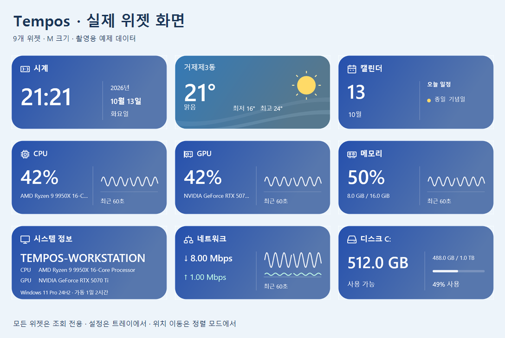

# Tempos v0.1.0 · Windows 11 x64

Windows 바탕화면에서 시간·날씨·PC 상태·일정을 확인하는 첫 공개 릴리즈입니다. 현재 사용자용 설치 EXE와 무설치 ZIP을 제공합니다.

**[Windows x64 설치 EXE](https://github.com/poyal/tempos/releases/download/v0.1.0/Tempos-0.1.0-win-x64.exe)** · [설치 EXE SHA-256](https://github.com/poyal/tempos/releases/download/v0.1.0/Tempos-0.1.0-win-x64.exe.sha256) · [무설치 ZIP](https://github.com/poyal/tempos/releases/download/v0.1.0/Tempos-0.1.0-win-x64.zip) · [스크린샷과 사용법](../../README.md)

## 위젯

- 시계·날씨·CPU·GPU·메모리·시스템 정보·네트워크·디스크·캘린더 9종, 크기별 37개 구성.
- 디지털 시계, CPU/GPU/메모리의 공통 그래프, 전체 네트워크 집계.
- 디스크 S/Slim/M은 선택한 볼륨, L은 전체 로컬 드라이브 목록. 7개 이상이면 자동 순환.
- 날씨와 낮밤에 따라 바뀌는 배경, 현재 위치로 지역을 한 번 선택하고 유지하는 기능.
- 조회 전용 Google 캘린더, 일정이 들어가는 XL 월간 달력.
- 선택 위젯에 맞는 설정, 정렬 모드, 투명도·테마·모니터 선택, 레이아웃 백업·복원, Windows 자동 시작.

## 설치와 업데이트

1. `Tempos-0.1.0-win-x64.exe`를 실행하고 설치 폴더를 선택합니다.
2. **설치 → 마침**을 누릅니다. 다음부터 바탕화면·시작 메뉴의 Tempos로 실행합니다.
3. 작업표시줄의 Tempos 아이콘에서 설정을 열어 위젯을 추가·배치합니다.

Passport와 같은 NSIS 설치 EXE 방식으로 현재 사용자에게 설치합니다. 기본 경로는 `%LocalAppData%\Programs\Tempos`이며 관리자 권한과 .NET 설치는 필요하지 않습니다. 전체 사용자 설치는 지원하지 않습니다. Windows x64 실행 파일과 지역 자료·사용법·스크린샷·외부 고지를 포함하며 macOS/Linux/ARM64 실행 파일은 배포하지 않습니다. GitHub의 **Source code**는 실행용 파일이 아닙니다.

업데이트할 때는 **앱 → 레이아웃 내보내기**로 백업하고 **Tempos 종료** 후 같은 폴더에 새 설치 EXE로 설치하세요. Windows의 **설치된 앱**에서 제거할 수 있으며 설정과 연동 정보는 `%LocalAppData%\Tempos`에 유지합니다. 설치·제거 시 실행 중인 앱을 강제로 종료하지 않습니다.

ZIP은 압축을 풀고 `Tempos.exe`를 실행합니다. 실행 파일과 `data` 폴더를 함께 유지하세요. ZIP에서 설치형으로 전환하면 기존 설정을 이어 쓰며 자동 시작은 새 앱에서 다시 등록합니다. [설치 화면과 사용법](../../README.md#install).

설치본은 기존 v0.1.0 ZIP의 검증된 앱 실행 파일을 그대로 사용합니다. 기존 ZIP과 `v0.1.0` 태그는 유지하고 설치 코드·추가 문서는 `v0.1.0-win-x64-installer` 태그로 구분합니다. [설치본 검증](../validation/installer-v0.1.0.md).

## 서비스와 확인 범위

- Open-Meteo는 키 없이 비상업적 이용에 사용할 수 있고, 기상청은 본인 API허브 키가 필요합니다. [날씨 안내](../weather.md).
- Google 일정은 본인의 데스크톱 앱 OAuth 클라이언트를 연결해야 합니다. 로컬 달력은 연결 없이 동작합니다.
- 실제 Windows UI에서 외부 API·OAuth·위치를 **목업**으로 검사했습니다. 로컬 시스템 수집은 Windows의 실제 카운터로 별도 확인했습니다.
- 실제 API 가용성·Google 웹 승인·실제 위치 권한·Windows 재로그인은 이번 릴리즈 검사 범위에 포함하지 않았습니다. 이미지의 날씨·장치·일정은 예제 데이터입니다.

[Release·ASan·E2E와 배포 검증 기록](../validation/release-v0.1.0.md) · [촬영 조건과 37개 크기별 원본](../screenshots.md#release-010) · [문의·오류 신고](https://github.com/poyal/tempos/issues)
