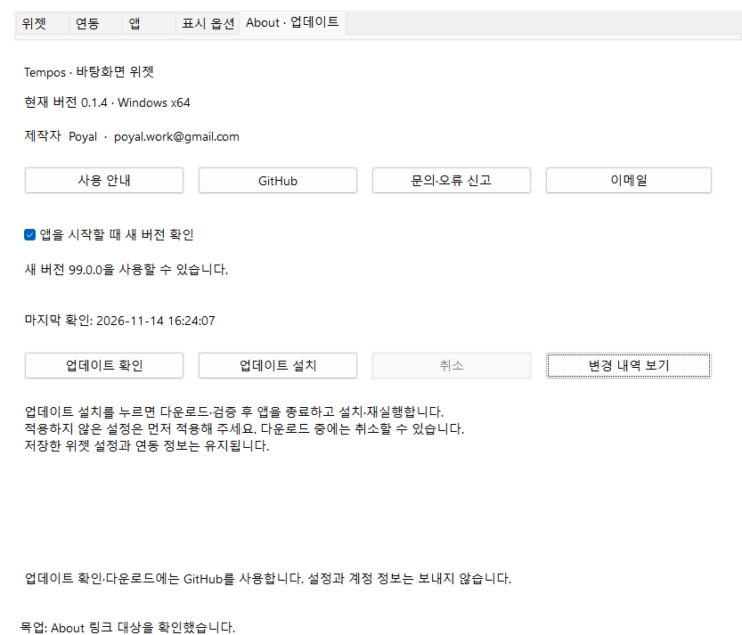

# 상세 사용 안내

설치부터 기본 조작은 [사용자 매뉴얼](../README.md)을 따르세요. 이 문서는 설정의 적용 범위와 복원 동작을 설명합니다.

## v0.1.5 위젯 편집과 배치

1. **위젯 → 내 위젯**에서 대상을 선택합니다. **이름**에 `서울 시계`처럼 목록에서 구분할 별칭을 입력할 수 있습니다.
2. **모양**, **표시할 정보**, **위치와 동작**에서 수정합니다. 미리보기에는 선택한 크기·테마·단위가 반영됩니다. **적용**하면 저장하고 **되돌리기**를 누르면 마지막 적용 상태로 돌아갑니다.
3. 같은 구성이 하나 더 필요하면 **복제**를 누르세요. 원본 크기가 들어가는 빈 자리에 독립된 위젯이 생깁니다.
4. **배치**에서 새 이름을 입력하고 **현재 배치 복사**를 누르면 복사본을 편집할 수 있습니다. 목록에서 다른 배치를 선택하고 **이 배치 사용**을 누르거나 트레이의 **배치**에서 전환하세요. 선택한 배치의 이름을 변경하거나 사용 중이지 않은 배치를 삭제할 수 있습니다.

배치마다 위치·크기·표시 옵션·기본 테마가 저장됩니다. 날씨 서비스와 계정, 로그인 시 시작 및 센서 설정은 PC에서 공유합니다. **배치 → 파일로 옮기기**의 JSON은 현재 배치 한 개를 담습니다. 가져오면 현재 배치와 전역 날씨 서비스가 파일의 값으로 바뀝니다.

[이전 화면과 개편 후 화면 비교](validation/tempos-before-after.html)

설정 항목은 선택한 위젯에 필요한 것만 표시합니다. 위젯 본체의 클릭·더블클릭·우클릭은 동작하지 않으며, 설정은 트레이에서 엽니다. 정렬 모드에서는 드래그로 이동할 수 있습니다.

| 항목 | 동작 |
| --- | --- |
| 크기·확대 | 지원되는 비율을 유지하며 화면에 들어갈 때만 적용 |
| 모니터 | 선택 화면에 배치. 분리 시 가능한 화면에 임시 배치 |
| 테마 | 전체 테마 사용 또는 개별 테마 선택 |
| 갱신 주기 | 위젯별 표시 주기. 날씨 외부 요청의 최소 간격은 별도 적용 |
| 배경 / 전체 투명도 | 배경만 또는 글자·아이콘까지 투명하게 표시 |
| 클릭 통과 / 위치 잠금 | 바탕화면 클릭 전달 / 이동 제한 |
| 항상 위 | 일반 창보다 위에 놓는 옵션 |
| 초 표시 / 그래프 | 해당 위젯에서 지원하는 표시 기능 |
| 날씨 지역 | 국내 지역 목록에서 선택. 같은 지역에서 외형만 바꾸면 저장 좌표 유지 |
| 현재 위치 찾기 | Windows 위치로 가까운 지역을 한 번 선택. 적용 후 해당 지역 유지, 자동 추적 없음 |
| 시간대 | 시계·캘린더에 적용. 비우면 Windows 시간대. 예: `Asia/Seoul` |

날씨 서비스 선택은 **연동** 탭의 전역 설정입니다. 온도 단위·지역·배경은 위젯별로 다르게 둘 수 있습니다. [날씨 안내](weather.md)를 확인하세요.

## 위젯별 상세

- **시계:** 모든 크기에서 디지털 시간·날짜를 표시합니다. S/Slim/M/L, 12/24시간, 초 표시를 지원하며 초 표시와 갱신 주기는 함께 조정됩니다.
- **CPU/GPU:** Windows 성능 카운터를 사용합니다. GPU별 엔진 합산 방식과 Windows 작업 관리자 표본 시점 때문에 순간 값이 다를 수 있습니다. S/Slim/M/L에서 사용률과 섭씨 온도를 표시하고, Slim/M/L은 최근 60초 추이, L은 평균·최대 사용률도 표시합니다. 모델명은 M/L 하단 한 줄에 표시하며 S/Slim에서는 숨깁니다. CPU 온도는 **앱 → CPU 온도 표시**에서 선택 설치한 센서 도우미를 사용하고, GPU 온도는 Windows·드라이버가 제공해야 표시됩니다. 미지원·오래된 온도는 `—`로 표시하며 사용률은 계속 수집합니다. 팬 속도는 제공하지 않습니다. [온도 설정과 색상 기준](../README.md#temperature).
- **메모리:** 물리 메모리 사용률·사용량/전체 용량을 표시합니다. Slim/M/L은 최근 60초 추이, L은 평균·최대 사용률을 함께 표시합니다.
- **네트워크:** 기본값 **전체 네트워크**는 연결된 실제 유선·무선 장치의 수신·송신을 합산합니다. 필터·터널 인터페이스는 제외합니다. 개별 어댑터를 선택할 수도 있으며 **표시할 정보**에서 비트/바이트 단위를 바꿉니다.
- **디스크:** S/Slim/M은 선택한 로컬 볼륨, L은 모든 로컬 볼륨의 사용/전체 용량과 계정에서 사용할 수 있는 공간을 표시합니다. L에는 볼륨 선택 필드가 없으며 작은 크기로 돌아가면 이전 선택을 사용합니다. 7개 이상은 6개씩 12초마다 자동 순환합니다. 잠긴 볼륨은 조회 불가로 표시하며 SMART 상태는 제공하지 않습니다.
- **시스템 정보:** PC·OS·CPU·GPU·가동 시간 중 표시할 항목을 고릅니다.
- **캘린더:** 계정 연결 없이 로컬 달력을 사용할 수 있습니다. 연결한 일정은 읽기 전용이며 L/XL의 월 이동은 설정의 **이전 달 / 오늘 / 다음 달**에서 합니다.

## 저장과 복구

설정은 `%LocalAppData%\Tempos\settings.json`에 저장됩니다. 적용·추가·제거·숨김과 배치 변경에서 저장하며 정상 종료에서도 저장합니다. 적용하지 않은 입력은 복원 대상이 아닙니다. 저장 실패 메시지가 뜨면 변경이 반영되지 않았는지 확인하세요.

정상 설정의 직전 사본은 `settings.backup.json`입니다. 설정 파일이 손상되면 정상 백업을 읽고 손상 파일을 진단용으로 보존합니다. 둘 다 사용할 수 없으면 기본 위젯으로 시작합니다. 빈 레이아웃은 정상 설정이므로 기본 위젯으로 채우지 않습니다.

레이아웃 가져오기는 현재 구성을 교체합니다. 키·일정은 포함하지 않으며 숨김은 가져오지 않습니다. 앱 전체 날씨 선택도 내보내기·가져오기에 포함됩니다. 공급자 필드가 없는 구버전 레이아웃은 기상청으로 가져옵니다. CPU 온도 활성화와 자동 시작 등록은 PC별 설정이므로 레이아웃에 포함하지 않으며 가져오기 시 해당 PC의 값을 유지합니다.

인증키·OAuth·날씨와 일정 캐시는 Windows 사용자 범위 DPAPI로 보호합니다. 다른 PC·사용자 계정에 복사한 파일이 그대로 복호화된다고 가정하지 마세요. 레이아웃을 가져온 뒤 필요한 서비스를 다시 연결합니다.

## About · 업데이트

v0.1.4부터 **About · 업데이트**에서 실행 파일의 현재 버전, 제작자 Poyal, 사용 안내·GitHub·문의·이메일을 확인한다. 앱 시작 때 정식 공개 릴리즈를 한 번 확인하며, 자동 확인을 끄더라도 **업데이트 확인**을 직접 누를 수 있다. 마지막 확인 시각은 PC의 현지 시각으로 표시한다. v0.1.3 이하에서는 새 설치 EXE로 한 번 수동 업데이트해야 이 기능을 사용할 수 있다.

화면은 v0.1.4 후보의 HTTP 목업 검사에서 촬영했다. 새 버전 `99.0.0`은 테스트 예제이며 실제 공개 버전이 아니다.

v0.1.6부터 등록된 설치형은 **업데이트 다운로드**로 서명된 패치 ZIP을 받는다. 위젯을 계속 사용하다가 **재시작하여 적용**을 누른다. 앱을 닫았다 열어도 준비된 다운로드를 다시 사용할 수 있다. 편집 중에는 적용·버리기·계속 편집 중 선택한다. 새 버전에서 기존 배치와 위젯이 열려야 설치 성공을 표시한다. 시작에 실패하면 이전 버전과 설정을 복원하고 결과를 **정보 및 업데이트**에 표시한다. 서명 또는 파일 검증 실패 시 **변경 내역 보기**에서 설치 EXE를 받을 수 있다. v0.1.4와 v0.1.5 설치형은 기존 **업데이트 설치**로 전환 버전을 받을 수 있다.

무설치 실행은 등록된 설치본을 변경하지 않는다. **변경 내역 보기**에서 새 ZIP을 받아 앱을 종료하고 교체한다. 자동 확인 설정은 이 PC의 설정이며 레이아웃 내보내기에 넣지 않고 가져올 때도 현재 값을 유지한다.

## 자동 시작과 별도 프로필

**Windows 로그인 시 시작**은 현재 실행 파일 경로를 Windows 사용자 시작 항목에 등록합니다. 체크 여부는 프로필 JSON과 별도로 유지합니다. Windows에서 차단한 시작 앱을 앱의 체크만으로 다시 허용하지는 않습니다.

개발·테스트용 `Tempos.exe --data-dir <폴더>`는 별도 데이터 폴더를 사용합니다. 해당 실행에서 자동 시작을 등록하면 데이터 폴더 경로도 함께 저장됩니다. 일반 배포 앱은 한 번에 하나만 실행되며, 실행 중 다시 열면 기존 설정창을 표시합니다.
