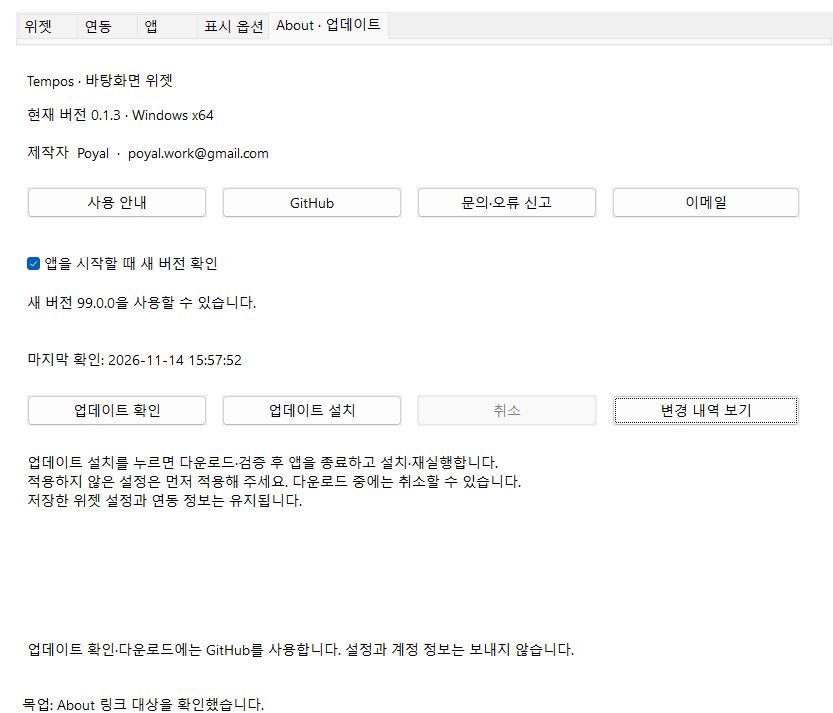

# About·업데이트 구현 검증 · 2026-11-14

Windows 설정에 **About · 업데이트**를 추가했다. 현재 버전·제작자·사용 안내·문의, 시작 시 정식 릴리즈 확인, 사용자가 업데이트 설치를 누른 뒤 다운로드·검증·종료·설치·재실행하는 흐름이다. 무설치 실행은 등록된 설치본을 변경하지 않는다. 현재 공개 v0.1.3에는 포함하지 않았고 설치본도 업데이트하지 않았다.

[실행별 결과·해시·SKIP 이유](2026-11-14-about-updates.json), [사용 안내](../user-guide.md#about--업데이트-개발-소스), [E2E 경계](../e2e.md#about업데이트).

## 최종 검증

- Release·ASan 단위 각각 **9,695 PASS**. 업데이트 관련 120개 추가 검사가 포함된다.
- Release E2E **825 PASS, 0 FAIL, 106 SKIP**.
- ASan E2E **152 PASS, 0 FAIL, 0 SKIP**.
- 새 업데이트 모드는 두 빌드에서 각각 **84 PASS, 0 FAIL, 0 SKIP**이다.
- 기존 저장 검사의 SKIP은 외부 창에 가린 바탕화면 입력 판정이다. 사용자 창을 강제로 닫거나 최소화하지 않았다.

| 모드 | PASS | FAIL | SKIP |
| --- | ---: | ---: | ---: |
| Release updates | 84 | 0 | 0 |
| Release api-mock | 68 | 0 | 0 |
| Release weather | 74 | 0 | 0 |
| Release persistence | 223 | 0 | 106 |
| Release options | 86 | 0 | 0 |
| Release edit-mode | 279 | 0 | 0 |
| Release isolation | 11 | 0 | 0 |
| ASan updates | 84 | 0 | 0 |
| ASan api-mock | 68 | 0 | 0 |

원본은 `test-results/full-validation-20261114-155750/manifest.json`, `test-results/full-validation-20261114-160046/manifest.json`에 있다. 초기 개발 실행과 최종 실행을 합산하지 않는다. 최초 E2E 러너 빌드에서 FlaUI 확장 메서드 namespace 누락을 고친 기록도 보존했다.

## 기능과 실패 처리

숫자 버전 비교와 정식 릴리즈만 허용, 같은/이전 버전 설치 금지, 고정된 저장소·파일명·HTTPS 호스트, 최대 256 MiB, 정확한 크기·SHA-256을 검사했다. 누락/중복/위조된 설치 파일, 잘못된 JSON, 요청 제한, 오류, 잘린/초과/변조된 파일, 외부 호스트 리디렉션과 리디렉션 반복, 취소를 다뤘다. 파일은 메모리에 한 번에 올리지 않고 디스크로 스트리밍한다.

시작 확인은 한 번만 실행하고 주기적 폴링은 하지 않는다. 자동 확인 설정은 저장·재시작 뒤에도 유지하고 레이아웃 내보내기에서 제외한다. 가져오기는 이 PC의 값을 유지한다. 다운로드 도중 종료하면 작업과 임시 파일을 정리한다.

설치 도우미는 부모 PID·생성 시각·경로, 파일 SHA-256을 다시 확인하고 준비/진행 이벤트로 인계한다. 원래 앱이 종료된 뒤에만 설치를 시작한다. 검증한 설치 파일은 설치 종료까지 쓰기·교체를 차단한다. 실제 Windows E2E는 별도 목업 설치 프로세스의 종료 0/7을 사용해 성공·실패 후 같은 TestHost와 프로필로 재실행하고 설정 불변을 확인했다. 한글·공백 경로도 사용했다. 실제 NSIS 설치·레지스트리 변경·설치된 새 버전 확인의 통과를 의미하지 않는다.

## 짧은 평상시 자원 확인

기본 M 위젯 5개, 외부 API 목업, 실제 로컬 Windows 수집으로 30초 준비 후 60.675초 측정했다. 평균 CPU 시간 **4.893 ms/초**, 평균/p95 전체 CPU **0.0408% / 0.1296%**, 최대 private/working set **18.35 / 42.99 MiB**이다. 필수 예산 판정은 **PASS**이며 업데이트 메타데이터 요청은 1회였다.

이는 새 기능의 단일 PC 짧은 점검이다. 30분 성능 검증, 두 PC 확인, 배터리/전력 검증으로 표현하지 않는다. 원본 `test-results/performance-about-update-idle-20261114-160234/report.json`을 보존한다.

## 화면과 배포 범위

99.0.0은 테스트용 메타데이터다. 캡처는 이번 Release TestHost의 실제 창이며 확인 시각은 PC 현지 시각이다. 공개 릴리즈·설치본·사용자 원본 설정을 변경하지 않았다. 실제 GitHub 다운로드와 실제 앱 설치 교체는 이번 검증 범위가 아니다.
