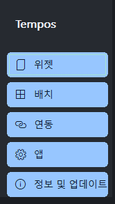
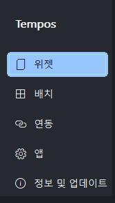

# 설정 메뉴와 위젯 선택 전후 비교

Windows에서 어두운 테마로 설정을 열고 **위젯 → 배치 → 연동 → 앱 → 정보 및 업데이트 → 위젯** 순으로 이동했다. 각 페이지에서 목록이나 입력 컨트롤로 포커스를 옮긴 후 다음 메뉴를 눌렀다. 두 캡처 모두 마지막에 열린 페이지는 ‘위젯’이다.

| 수정 전 | 수정 후 |
| --- | --- |
|  |  |

이전 빌드에서는 페이지 제목과 본문이 정상적으로 바뀌어도 이전 버튼에 강조색이 남았다. 페이지가 바뀔 때 직접 그리는 이전·새 메뉴 버튼에 다시 그리기를 요청하도록 수정했다. 이전 화면 검수는 촬영 직전에 모든 컨트롤을 새로 그렸다. 이번 비교는 각 버튼 DC의 실제 배경 픽셀을 읽고, 설정창 DC에서 같은 영역을 복사했다.

## 같은 188개 시나리오를 두 빌드에서 실행한 결과

| 시나리오 | 수 | 수정 전 불일치 | 수정 후 불일치 |
| --- | ---: | ---: | ---: |
| 5개 출발 페이지 × 5개 도착 페이지 × 넓은 창·좁은 창 × 테마 예제 3종 | 150 | 63 | 0 |
| 각 페이지에서 창을 넓히거나 좁힐 때 페이지와 선택 표시 유지 | 30 | 0 | 0 |
| 본문을 사용하며 다섯 메뉴를 한 바퀴 돈 뒤 첫 메뉴로 복귀 | 3 | 3 | 0 |
| 탐색·창 크기·테마를 변경한 뒤 저장한 위젯 설정 대조 | 1 | 0 | 0 |
| 기본 위젯 다섯 줄의 표시 높이 | 1 | 1 | 0 |
| 위젯 변경 중 다른 위젯 선택 후 계속 편집·버리기·적용 | 3 | 1 | 0 |
| **합계** | **188** | **68** | **0** |

- **목록 높이.** 이 PC에서 목록 안쪽은 72픽셀, 각 항목은 19픽셀이어서 넷째 줄이 잘렸다. 현재 DPI의 실제 항목 높이와 테두리 두께로 다섯 줄 높이를 계산한다. 더 많은 위젯은 목록을 스크롤해 선택한다.
- **편집 대상.** 첫 위젯의 이름을 수정하고 둘째 위젯을 선택해 ‘적용’을 누르면, 저장 과정이 목록을 다시 채우면서 강조가 첫 위젯으로 돌아갔다. 이제 저장을 마친 뒤 요청한 행을 선택하고 같은 위젯의 편집기를 연다. 계속 편집과 버리기 경로도 저장된 이름과 대조했다.

## 재현 조건

두 빌드 모두 같은 E2E 실행 파일과 `--settings-navigation`을 사용했다. 96 DPI 모니터 한 대에서 넓은 창은 900, 좁은 창은 540 논리 픽셀 너비로 설정했다. 밝게·어둡게·고대비는 TestHost 전용 예제다. 실제 Windows 창과 실행별 설정 파일을 사용했고 외부 API는 목업으로 실행했다.

| 빌드 | TestHost SHA-256 | `test-results` 아래 실행 폴더 |
| --- | --- | --- |
| 수정 전 | `904C0EFB602A532B75BCE996A23C1FB32F24D23882DD5D26529D86F6A8DFA27D` | `e2e-20261125-091903-635` |
| 수정 후 | `44C95FF58A0E36EF43D33497893FBF7108E5276D0A356DF4E6A6A5E38A0B3812` | `e2e-20261125-092007-552` |

첫 두 예비 실행에서는 메뉴 사이만 오가는 경로로 목록 높이와 편집 대상 불일치 2건을 재현했다. 본문으로 포커스를 옮기는 조작을 추가한 뒤 위 표의 두 실행에서 동일한 절차를 비교했다. 원본 판정은 각 폴더의 `results.json`에 있다. 표의 188개는 시나리오별 판정이며 실행 준비·종료·격리 검사는 별도로 기록된다.

## 전체 회귀에서 발견한 검사 도구 문제

- `--interaction`은 미저장 값이 드래그 뒤에도 남는지 검사하면서 진단값을 읽기 위해 앱 페이지로 이동했다. 확인창 때문에 검사가 멈췄고, 해당 TestHost에서 ‘계속 편집’을 선택하자 숨겨진 진단 버튼을 찾지 못해 실패했다. 편집 페이지를 유지하며 진단을 읽도록 고친 뒤 드래그 검사 22개가 통과했다.
- 첫 `--updates` 실행에서 118개 검사가 통과했지만 전체 실행기는 교체된 파일을 이전 버전 해시와 비교해 중단했다. 시작 파일과 최종 파일을 따로 기록하고 교체 후에는 업데이트 후보 해시와 대조하도록 수정했다. 재실행에서도 118개가 통과했고 전체 실행기가 다음 모드로 진행했다.

위 두 실행은 각각 `full-validation-20261125-092007`, `full-validation-20261125-092337`에 보존했다. 업데이트 재실행부터의 기록은 `full-validation-20261125-092718`에 있다.

## 수정 후 Windows 회귀 결과

기본 회귀 27개 모드의 최종 실행에서 **4,324개 통과, 실패 0개, 건너뜀 116개**였다. 새 모드의 시나리오 188개는 이 수치에 포함된다. 별도로 Release 핵심 검사 9,705개가 통과했다. 날씨·위치·OAuth·캘린더·업데이트 HTTP는 목업이었다. `--windows-real`에서는 Windows 로컬 자료를 실제로 수집했다. 설치·제거, 장시간 스트레스·지속 검사, 외부 API 실연동은 이번 범위에서 제외했다.

| 회귀 모드 | 통과 | 실패 | 건너뜀 |
| --- | ---: | ---: | ---: |
| settings-navigation | 202 | 0 | 0 |
| workspace-editor | 62 | 0 | 0 |
| edit-mode | 279 | 0 | 0 |
| interaction | 22 | 0 | 0 |
| drag-performance | 22 | 0 | 0 |
| geometry-matrix | 711 | 0 | 0 |
| render-cache | 91 | 0 | 0 |
| legacy-grid | 28 | 0 | 0 |
| shell-actions | 16 | 0 | 0 |
| updates | 118 | 0 | 0 |
| persistence | 223 | 0 | 106 |
| options | 86 | 0 | 0 |
| failures | 140 | 0 | 0 |
| capacity | 83 | 0 | 1 |
| placement | 60 | 0 | 0 |
| api-mock | 68 | 0 | 0 |
| weather | 74 | 0 | 0 |
| startup | 25 | 0 | 1 |
| isolation | 11 | 0 | 0 |
| clock-layout | 118 | 0 | 0 |
| matrix | 174 | 0 | 0 |
| behavior | 33 | 0 | 0 |
| temperature | 508 | 0 | 0 |
| ui-review | 532 | 0 | 0 |
| design | 574 | 0 | 0 |
| visual | 10 | 0 | 6 |
| windows-real | 54 | 0 | 2 |

외부 창에 가려 포인터 적중을 확인할 수 없었던 경우가 112개였다. 나머지는 실제 재로그인, 설치 앱 실행 중의 바탕화면 전환, GPU 온도, 실제 OS 마우스 드래그 각 1개였다.

처음 두 번의 `--windows-real` 실행에서는 OS가 입력을 접수했으나 시계 좌표가 바뀌지 않아 실패했다. 단계별 검사에서는 시계가 마우스를 캡처하지 못했고, 임시 진단 빌드에서는 시계에 누름 메시지가 도착하지 않았다. 같은 지점에 띄운 별도 WinForms 창도 누름을 받지 못했다. 최종 실행에는 같은 TestHost 해시를 사용했고 `input-reference.json`에 두 관측값이 모두 `false`로 기록됐다. 실제 포인터 드래그는 미검증으로 남겼다. 메시지 기반 드래그 검사와 별도로 판단했다.

실제 입력의 첫 실패부터 세 번의 기록은 `e2e-20261125-093720-761`, `e2e-20261125-093823-053`, `e2e-20261125-093928-195`이고 임시 진단 실행은 `e2e-20261125-094214-979`이다. 최종 Windows 실행은 `full-validation-20261125-094628` 및 `e2e-20261125-094629-591`에 있다. 이전 실패·진단 실행을 합계에 중복 산입하지 않았다.
