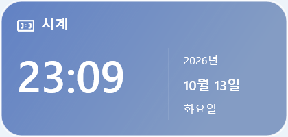

# v0.1.1 정렬 모드와 설치 프로파일 보호 검증

2026-10-13 Windows 11 Pro x64, 기본 모니터 3840×2160·150%, 보조 모니터 1920×1080·125%에서 검사한다. 보조 모니터는 기본 모니터 아래에 있으며 사용자 위젯 6개가 모두 보조 모니터에 배치된 조건이다.

## 재현과 수정

설치된 앱은 그대로 실행한 채 레이아웃 JSON을 `test-results`의 실행별 폴더로 복사했다. E2E가 실제로 조작하는 것은 별도 `Tempos.TestHost.exe`이며 날씨·위치·OAuth·캘린더 API는 목업이다. 사용자 인증 파일은 복사하지 않는다.

기존 창 개수·`IsWindowVisible`·Z 순서 검사만으로는 반복 전환이 통과했다. 실제 화면을 추가하자 세 번째 정렬 전환에서 클릭 영역은 남고 위젯 그림은 사라지는 현상을 재현했다. 수정 전 재현 실행은 `e2e-20261013-225444-813`, 투명 창 재설정 후 통과 실행은 `e2e-20261013-225616-782`다. 이 개발 중 실행들은 최종 결과에 합산하지 않는다.

바탕화면에 붙은 창과 정렬용 독립 창 사이에서 부모를 바꿀 때 `WS_EX_LAYERED`를 해제했다 다시 설정해 투명 창 표면을 재생성한다. `SetParent` 중 DPI 알림으로 중복 위치 처리·그리기가 발생하지 않게 한다. 정렬 중에는 격자·위젯·설정창의 앞뒤 순서를 보장하고 종료하면 저장된 항상 위 선택을 복원한다.

## 설치 앱 보호

- TestHost는 명시적인 별도 데이터 경로가 있어야 하며 설치된 사용자 프로파일 및 하위 경로는 실행 전에 거부한다. 상대 경로·대소문자·정규화된 경로도 비교한다.
- TestHost 관리 창과 단일 실행 식별자를 프로파일별로 구분해, 중복 실행이 설치된 앱이나 다른 테스트 창을 찾지 않게 한다.
- 일반 E2E는 진단의 실제 데이터 경로가 해당 실행의 테스트 폴더인지 확인한다.
- 검사 전후 설치 레이아웃·백업의 파일 해시와 실제 자동 시작 값을 비교한다. 바뀐 경우 실패로 기록하고 사용자 변경을 자동 복원하거나 덮어쓰지 않는다.
- 기존 설치·사용자 앱이 있으므로 이번 작업에서 설치·제거 수명주기 검사는 실행하지 않는다. 기존 설치 엔진은 [v0.1.0 검증](installer-v0.1.0.md)을 참조하며 v0.1.1에서 재실행한 수치로 표시하지 않는다.

## 결과 기록

최종 실행 파일로 Release·ASan 핵심 검사, 기본 모니터와 보조 모니터의 반복 정렬·실제 화면·항상 위 복원·재시작, 프로파일 격리와 자동 시작 회귀를 확인한다. 검사별 시각·해시·통과·실패·SKIP과 배포 파일 확인은 실행 후 이 문서에 추가한다. 실제 외부 서비스·실제 Windows 재로그인은 검사하지 않는다.

개발 중 실패도 보존한다. 초기 픽셀 캡처는 다른 창의 글자를 위젯 내용으로 오인할 수 있어 실제 화면의 입력 대상이 테스트 위젯인지 먼저 확인하도록 보강했다. 격리 검사의 전체 바탕화면 UIA 조회가 대기하는 문제는 소유 PID의 네이티브 창 조회로 고쳤다. 숨김 상태의 중복 실행은 첫 `ShowWindow`가 창을 다시 숨기는 문제가 있어 소유 창에 비동기 표시 요청을 보내도록 수정했다.

## 최종 결과

소스 태그 `v0.1.1`, 커밋 `a8f7706bae909c76a86208acf4b2a418ab4a3f8d` 기준이다. 23:08~23:10 KST의 최종 실제 Windows E2E는 **354개 통과·실패 0·SKIP 1**이다.

| 검사 | 통과 | 실패 | SKIP |
| --- | ---: | ---: | ---: |
| Release 핵심 검사 | 202 | 0 | 0 |
| ASan 핵심 검사 | 202 | 0 | 0 |
| 프로파일 접근·창 격리 | 11 | 0 | 0 |
| 기본 모니터 정렬·화면·복원 | 150 | 0 | 0 |
| 보조 모니터 복사 레이아웃 정렬·화면·복원 | 168 | 0 | 0 |
| 테스트 전용 자동 시작·재시작 | 25 | 0 | 1 |

각 모니터에서 정렬 12회와 서로 다른 항상 위 설정으로 4회 더 전환했다. 실제 픽셀 캡처와 입력 대상, 위젯 목록·ID, 설정 보존·재시작, 종료 후 항상 위 복원을 확인했다. 모든 최종 실행에서 설치 레이아웃·백업·자동 시작 값이 그대로임을 확인했다. SKIP은 실제 Windows 재로그인이다. 설치·제거 수명주기는 설치된 사용자 앱을 보존하기 위해 **별도 미실행**으로 남기며 이 합계에 포함하지 않는다.

| 세 번째 전환: 표면 초기화 전 | 세 번째 전환: 수정 후 |
| --- | --- |
|  |  |

[열한 번째 전환 화면](edit-v0.1.1/after-eleventh-toggle.png)도 정상이다. 실제 테스트 앱 영역만 캡처했으며 사용자 바탕화면이나 인증 정보를 게시하지 않는다. [실행별 시각·SHA-256·단언·재시도·캡처 해시](release-v0.1.1.json).

설치 EXE는 6,337,986바이트, SHA-256 `D236767E5D31D8C2F88D490F6B670A5D623D122692345A832742A7AE580C7A13`이다. ZIP SHA-256은 `E4648BC847643F1B33BBFEB6A22E7A9E23F4019A6F3C29C4B7A3755145AAECFE`다. 설치 payload의 앱 실행 파일은 검증한 Release 파일과 일치한다. 문서 19개·로컬 참조 300개·PNG 67개·설치 화면 2개를 패키지 안에서도 검증했다.

이 최종 결과와 화면은 패키징 후 문서만 추가한 기록이다. 설치 파일은 재포장하지 않는다. Win32 동작 참고: [SetParent와 DPI](https://learn.microsoft.com/en-us/windows/win32/api/winuser/nf-winuser-setparent), [투명 창 표면 초기화](https://learn.microsoft.com/en-us/windows/win32/winmsg/window-features#layered-windows).
