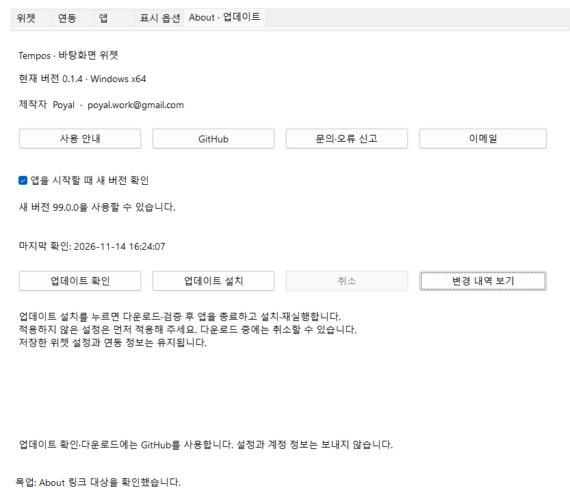

# v0.1.4 릴리즈 후보 검증 · 2026-11-14

About·업데이트 기능을 포함한 최종 버전 0.1.4로 다시 빌드하고 검사했다. [실행별 해시·SKIP·명령](release-v0.1.4.json), [릴리즈 노트](../releases/v0.1.4.md), [개발 단계 결과](2026-11-14-about-updates.md).

## 후보와 결과

빌드 기준은 `7e4f49bd04e5dff1dc3bcb214e99b5bf0e6761d7`와 당시 미커밋 변경이다. 최종 소스는 `v0.1.4` 태그로 고정한다. 테스트 후 배포 앱을 재빌드하지 않고 `package.ps1 -SkipBuild`로 포장한다.

- 배포 앱 SHA-256: `8C708FA9E1AF13BE8E7B0CE4E57AC93E78301E30AFF13CFBBAB473F0AD8AF0A6`.
- Release TestHost SHA-256: `41D6D34AEDE26489A3984B51222898FCE98C4104FAD52BCBC52293CD45A7E2A2`.
- ASan TestHost SHA-256: `34081FD8FB68B16B2807B2B53911A4CC8D594CAE2477025E461FC8776D822AE2`.
- Release·ASan 단위 각각 **9,695 PASS**, 센서 **22 PASS**.
- Release E2E **877 PASS, 0 FAIL, 108 SKIP**.
- ASan E2E **152 PASS, 0 FAIL, 0 SKIP**.
- 업데이트 E2E는 각 빌드 **84 PASS, 0 FAIL, 0 SKIP**이다. About와 Windows 파일 버전이 0.1.4로 일치함을 포함한다.

| 모드 | PASS | FAIL | SKIP |
| --- | ---: | ---: | ---: |
| Release updates | 84 | 0 | 0 |
| Release api-mock | 68 | 0 | 0 |
| Release weather | 74 | 0 | 0 |
| Release persistence | 223 | 0 | 106 |
| Release options | 86 | 0 | 0 |
| Release edit-mode | 279 | 0 | 0 |
| Release isolation | 11 | 0 | 0 |
| Release windows-real | 52 | 0 | 2 |
| ASan updates | 84 | 0 | 0 |
| ASan api-mock | 68 | 0 | 0 |

원본은 `test-results/full-validation-20261114-162404/manifest.json`, `test-results/full-validation-20261114-162729/manifest.json`에 보존했다. SKIP의 실제 항목과 이유는 JSON에 남기며 외부 창 가림·온도 미지원·전역 바탕화면 상태 보호 등을 통과로 바꾸지 않는다.

## 최초 실패와 수정

첫 후보의 About는 0.1.4인데 Windows 파일 속성은 0.1.3으로 남아 버전 일치 E2E가 실패했다. Ninja의 RC include 의존성이 자동 추적되지 않아 VERSIONINFO가 갱신되지 않은 문제다. 생성된 `version.h`를 RC의 명시적인 `OBJECT_DEPENDS`로 추가하고 Release·ASan을 다시 빌드했다. 이후 기존 동일 검사와 전체 예정 회귀 검사를 통과했다. 최초 실패와 해시는 결과 JSON 및 `test-results/release-v0.1.4-release-e2e.log`에 보존하며 최종 통과 수에 합산하지 않는다.

## 자원 확인과 검사 경계

기본 M 위젯 5개로 30초 준비 뒤 **60.650초** 측정했다. 평균 CPU 시간 **3.607ms/초**, 평균/p95 전체 CPU **0.0301% / 0.1293%**, 최대 private/working set **18.57 / 43.13MiB**다. 필수 예산은 PASS, 별도 4ms/초 목표는 **충족**이다. 짧은 단일 PC 점검이며 30분·두 PC 성능 또는 전력·배터리 검증이 아니다.

일반 E2E의 외부 API는 HTTP 경계 목업이다. 실제 파일 저장·SHA-256·도우미 복사·부모 PID/생성 시각/경로 확인·준비/진행 핸드셰이크·종료 대기·재실행과 설정 보존을 검사했다. 설치 실행은 TestHost 전용 목업 프로세스의 성공/실패 코드로 검증했다. 현재 사용자 설치가 있어 실제 NSIS 설치·제거·등록 변경·설치된 새 버전 확인은 수행하지 않았다. 실제 GitHub 다운로드/실연동도 앱 검사에서 수행하지 않았다.

매 E2E 실행에서 사용자 레이아웃·백업·자동 시작 등록 불변을 확인했다. 기존 설치본을 종료하거나 업데이트하지 않았다. 배포 EXE·ZIP에는 검증한 동일 앱을 넣으며 패키징 후 문서·파일 목록·버전·해시를 별도로 확인한다. 게시 후에는 공개 다운로드 재검증 영수증만 문서 후속 커밋으로 추가한다.

