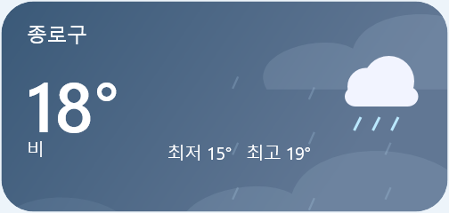
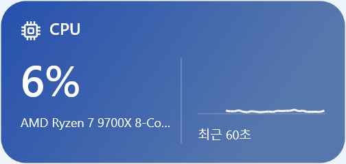
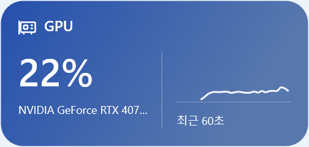

# 실제 Windows E2E · 2026-10-13

Windows 11 Pro **10.0.26300 x64**의 실제 사용자 세션에서 배포 ZIP을 새로 풀어 `Tempos.exe`를 검사했다. TestHost와 예제 공급자를 사용하지 않았다. 실제 메모리 그래프가 비어 있는 결함을 찾아 수정했고, 수정한 ZIP에서 관련 E2E **143개 통과·실패 0개·SKIP 2개**, 핵심 검사 **195개 통과**를 확인했다.

검사 시각은 07:52:20–08:30:13 KST다. 앱과 검사기는 같은 사용자 세션에서 실행했고 모니터 DPI는 144·120이었다. 실행별 시각, 각 확인 항목, 초기 실패, 실행 파일·캡처 해시는 [results.json](results.json)에 보존한다. 성공 수는 자동 단언 개수이며 기능 개수나 전체 코드 커버리지가 아니다.

## 실제 수집에서 발견한 메모리 결함

사용률 숫자는 갱신되지만 `ProviderService::publish`가 메모리를 이력 누적 대상에서 빠뜨려 그래프와 평균·최대에 자료가 없었다. 예제 데이터 화면에서는 드러나지 않아 실제 화면을 열어 확인한 뒤 회귀 검사를 추가했다.

1. 수정 전 실제 메모리 수집기로 연속 샘플을 기다리는 검사를 실행하여 실패를 재현했다.
2. CPU·GPU·네트워크와 같은 이력 누적 분기에 메모리를 포함했다. 날씨 렌더링은 변경하지 않았다.
3. 핵심 검사 195개, 실제 메모리 그래프 영역의 선 픽셀 검사, 저장·재시작과 공유 수집·옵션 검사를 통과했다.

| 수정 전: 숫자만 표시 | 수정 후: 실제 이력 표시 |
| --- | --- |
|  |  |

## 실행 파일별 결과

첫 번째 ZIP(`79f8387` 기준)의 최종 모드별 결과는 아래와 같다. **메모리 결함을 수정하기 전 실행**이므로 수정한 실행 파일의 결과로 합산하지 않는다. 자동 검사 통과 뒤 캡처 검토에서 결함을 발견한 사실도 함께 보존한다.

| 모드 | 통과 | SKIP | 확인 범위 |
| --- | ---: | ---: | --- |
| `--smoke` | 6 | 0 | 배포 파일·지역표·초기 실행·종료 |
| `--live-smoke` | 5 | 0 | 실제 CPU·GPU·메모리 |
| `--matrix` | 170 | 0 | 9종 37개 크기·200% 확대·트레이 |
| `--behavior` | 27 | 0 | 공유 수집·숨김·실제 모니터 DPI·파일 내보내기/가져오기 |
| `--clock-layout` | 114 | 0 | 시계 16개 표시 조합과 내용 픽셀 |
| `--failures` | 93 | 0 | 잘못된 입력·잠긴 파일·저장 실패·손상 복구 |
| `--interaction` | 9 | 0 | Win32 메시지 기반 드래그·잠금·클릭 통과 |
| `--persistence` | 316 | 0 | 9종 추가·설정·바탕화면 히트 테스트·숨김·삭제·재시작 |
| `--options` | 79 | 0 | 표시 단위·테마·배율·달 이동·설정 보존 |
| `--visual` | 7 | 1 | 실제 바탕화면 배치, Show Desktop 시도 |
| `--windows-real` | 30 | 2 | 실제 공급자·전체 네트워크·로컬 드라이브·날씨 응답·화면·재시작 |
| 합계 | **856** | **3** | 최종 모드별 실패 0개 |

최초 `--options`는 낮은 트래픽의 `B/s`를 허용하지 않는 검사 오류로 실패했다. 수신·송신 두 값 모두 `B/s`부터 `TiB/s`까지 확인하도록 고쳤고 같은 실행 파일에서 다시 통과했다. 초기 실패 1건이 원본에는 단언 실패와 예외 처리로 두 번 기록되며, 그 실행의 성공 수는 위 합계에 더하지 않았다.

메모리 결함을 수정한 실행 파일은 ZIP을 다시 만들고 새 폴더에 풀어 아래 검사를 실행했다. 위의 11개 모드를 전부 새 실행 파일에서 반복했다는 뜻은 아니다.

| 모드 | 통과 | SKIP |
| --- | ---: | ---: |
| `--windows-real` — 실제 메모리 그래프 선 검사 추가 | 31 | 2 |
| `--smoke` | 6 | 0 |
| `--behavior` | 27 | 0 |
| `--options` | 79 | 0 |
| 수정 후 E2E 합계 | **143** | **2** |
| 수정 후 핵심 검사 | **195** | **0** |

수정 후 실행의 실패는 0개다. 메모리 이력 수정 전후 회귀 검사와 핵심 검사 195개의 항목도 JSON에 기록했다.

## 실제 실행 화면

모든 이미지는 수정한 배포 앱의 위젯 영역만 캡처했다. M 크기(캘린더는 L), 위젯 확대 100%, Windows 배율 150%, 배경 투명도 0%이며 촬영용 단색 창을 뒤에 두었다. 기본 배경 투명도는 10%다. 개인 프로파일·전체 바탕화면·PC 이름·드라이브 이름·네트워크 식별자는 공개하지 않았다.

| 시계 | 실제 Open-Meteo 날씨 |
| --- | --- |
|  |  |

| 실제 CPU | 실제 GPU |
| --- | --- |
|  |  |

| 실제 메모리 | 실제 전체 네트워크 |
| --- | --- |
|  |  |

날씨는 초기 기본 지역인 서울 종로구의 실제 응답이다. 현재 위치로 선택한 결과가 아니다. 실제 전체 로컬 드라이브 목록·용량은 Windows `DriveInfo`와 대조했지만 개인 볼륨명이 있는 화면은 공개하지 않았다. 7개 수정 후 캡처를 모두 직접 열어 텍스트·아이콘·그래프와 가림 여부를 확인했다.

## SKIP과 완료 범위

- **OS 마우스 입력:** 최종 재확인에서 `SendInput`은 전송 성공을 반환했지만 1초간 실제 커서 이동이 관측되지 않아 드래그 성공으로 기록하지 않았다. 입력 결과는 JSON에 보존하며 재확인의 성공 수를 중복 합산하지 않는다. 별도 네이티브 메시지 검사는 통과했지만 실제 OS 입력과 다르다.
- **Show Desktop / Win+D:** `Shell.ToggleDesktop`에 관측 가능한 변화가 없어 SKIP으로 남겼다. 물리 키보드 검사는 완료하지 않았다.
- **실제 현재 위치:** 자동 승인 검토가 Windows 위치 조회와 선택 지역 좌표의 `api.open-meteo.com` 전송을 명시적 동의 부족으로 거부했다. 승인을 요청한 상태로, 이번 실행에서는 위치 API를 호출하지 않았다. 기본 지역 날씨 요청은 실제 현재 위치 요청과 구분한다.

실제 Google OAuth·기상청 개인 키·Windows 로그온·물리 모니터 분리·여러 NIC의 동시 트래픽·장기 누수 검사는 이번 실행에 포함하지 않았다. 과거 모의 위치·예제 데이터·성능 검사 결과를 이번 실측 성공으로 바꾸지 않는다.

## 실행 파일과 재현

| 파일 | SHA-256 |
| --- | --- |
| 수정 전 `Tempos.exe` | `4db9504c57eab3bcac55c8c49ae252b221004f099d5f7824dc19935dbb9c6c60` |
| 수정 후 `Tempos.exe` | `0a7b400ea116d637efc97057f9f5be6b487e1308245bbbd68eff840026df5b59` |
| `Tempos-windows-verified-20261013-win-x64.zip` | `603944d4973181141c08dafdf08e545975169c4afb5df13c6b677bfd0c8fe782` |

ZIP은 로컬 `artifacts/`에 있으며 실행 파일과 데이터·문서를 포함한다. 이번 결과 보고서는 저장소에 별도로 보존하고, 검사한 ZIP은 해시를 유지했다. GitHub Release 게시와는 구분한다.

[E2E 실행 안내](../../e2e.md)에 따라 Windows 사용자 세션에서 모드를 하나씩 순차 실행한다. `--windows-real`에는 압축을 푼 `Tempos.exe`를 지정한다. 현재 위치를 검사하려면 위치 조회·좌표 전송에 대한 사용자 승인 후에만 `--allow-location-to-open-meteo`를 추가한다. 실행별 격리 데이터와 전체 원본은 로컬 `test-results/`에 유지한다.
